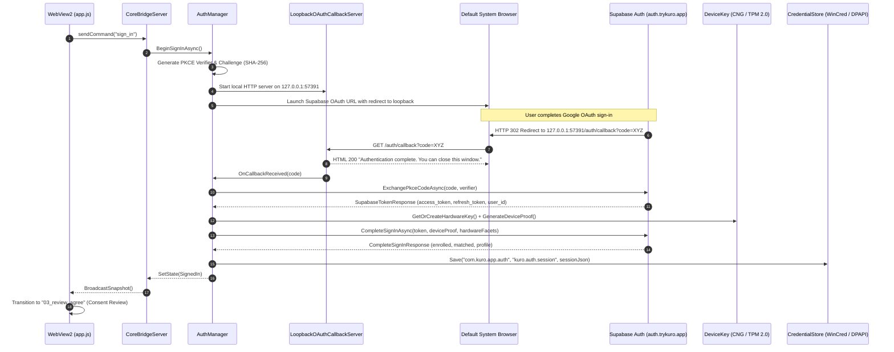
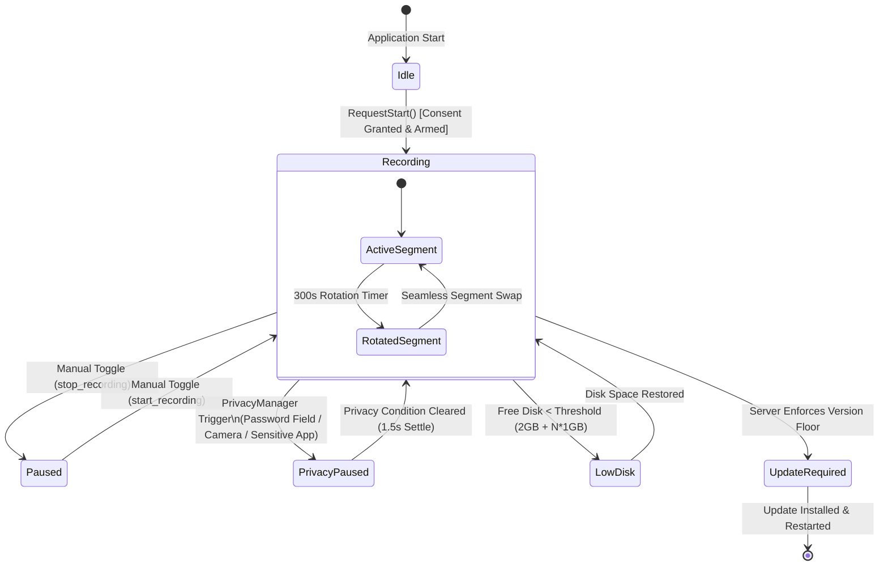
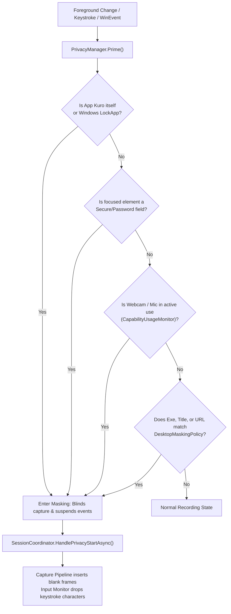
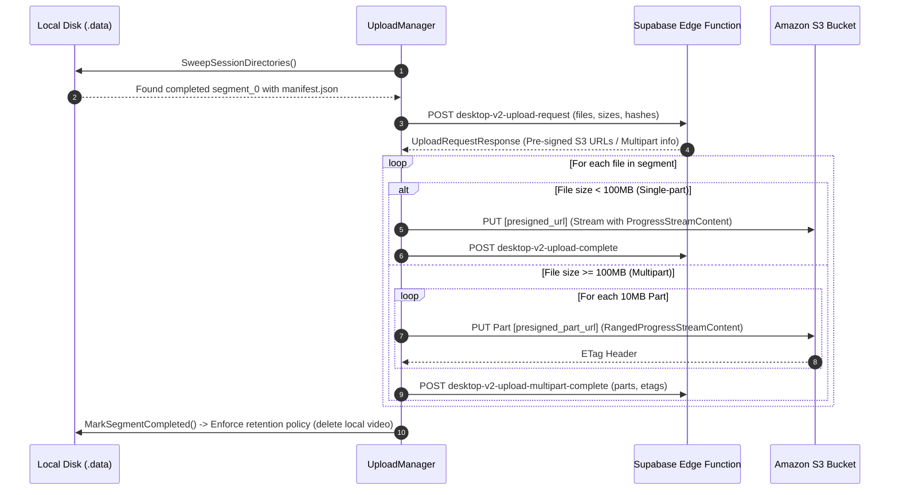

# Application Flow & Execution Sequences - Kuro Windows Desktop

> **Document:** `APPLICATION_FLOW.md`  
> **Source Target:** `KuroWindows/Program.cs`, `KuroWindows/App.xaml.cs`, `SessionCoordinator.cs`, `AuthManager.cs`, `UploadManager.cs`

---

## 1. Application Initialization & Bootstrap Sequence

When `KuroWindows.exe` launches, it executes a strict deterministic sequence to establish process identity, configure crash dumps, verify single-instance ownership, and initialize subsystems:

```mermaid
sequenceDiagram
    autonumber
    participant OS as Windows OS
    participant Main as Program.Main()
    participant UIA as UiaProbeWorker
    participant WER as CrashDiagnostics
    participant Velo as VelopackApp
    participant Mutex as SingleInstanceMutex
    participant Pipe as AppCommandServer
    participant App as App.OnStartup()

    OS->>Main: Launch KuroWindows.exe (args)
    alt args contains "--uia-probe"
        Main->>UIA: UiaProbeWorker.Run(args)
        Note over UIA: Runs isolated UIA MTA worker; never loads WPF
    else Normal / Background Launch
        Main->>WER: InstallProcessHandlers() + ConfigureWerLocalDumps()
        Main->>Main: SeedDesktopConfigFromCache()
        Main->>Velo: VelopackApp.Build().Run()
        
        Main->>Mutex: new Mutex(initiallyOwned: true, "Global\\KuroWindows_SingleInstance")
        alt Mutex Not Acquired (Second Instance Running)
            alt args contains "--auth-callback"
                Main->>Pipe: ForwardCallbackToRunningInstance(url)
            else Normal Launch
                Main->>Pipe: SendCommandToRunningInstance("show-settings")
            end
            Main->>OS: Exit Process (0)
        else Mutex Acquired (Primary Instance)
            Main->>App: app.InitializeComponent() + app.Run()
        end
    end
```

### Detailed Initialization Steps

1. **Subprocess Dispatch Check (`Program.Main`):**
   - Inspects `args[0]`. If `--uia-probe`, execution redirects immediately to [`UiaProbeWorker.Run(args)`](file:///d:/Kuro%20and%20Loggy3/extracted/lib/app/KuroWindows.dll), bypassing the entire WPF, capture, and UI stack.
2. **Crash & Dump Instrumentation:**
   - Installs unhandled exception handlers for `AppDomain.CurrentDomain.UnhandledException`, `TaskScheduler.UnobservedTaskException`, and `DispatcherUnhandledException`.
   - Modifies registry under `HKCU\Software\Microsoft\Windows\Windows Error Reporting\LocalDumps\KuroWindows.exe` to enable custom mini-dump captures (`DumpFolder = %LOCALAPPDATA%\CrashDumps`, `DumpType = 1`, `DumpCount = 3`).
3. **Local Policy Seeding:**
   - Reads [`CachedDesktopConfig`](file:///d:/Kuro%20and%20Loggy3/extracted/lib/app/KuroWindows.dll) from `%APPDATA%\Kuro\desktop_config.json`.
   - Immediately applies video bitrates, H.264 wire profiles, audio policies, and masking lists to guarantee privacy protection before any cloud network calls succeed.
4. **Velopack Hook Execution:**
   - Initializes Velopack runtime hooks; registers fast uninstall callback to clean up the `HKCU\...\Run` startup registry key.
5. **Single-Instance Mutex Arbitration:**
   - Attempts to acquire global named mutex `Global\KuroWindows_SingleInstance`.
   - If blocked, connects to named pipe `\\.\pipe\KuroWindowsAppCommand`, sends `show-settings`, and shuts down.
6. **Hardware & Cryptographic Warmup:**
   - In background tasks: warms up TPM 2.0 Platform Crypto Provider (`DeviceKey.WarmUp()`), TPM Endorsement Key (`TpmEndorsement.WarmUp()`), and SMBIOS/Motherboard facets (`HardwareFacets.WarmUp()`).
7. **Storage Recovery & Manager Initialization:**
   - Instantiates [`StorageManager`](file:///d:/Kuro%20and%20Loggy3/extracted/lib/app/KuroWindows.dll), creating root storage `%APPDATA%\Kuro\.data\` (marked with hidden file attribute).
   - Scans for interrupted sessions (`InterruptedSessionRecovery.Recover`), sealing any dangling clips left by ungraceful power loss or crashes.
8. **Core Engine Construction:**
   - Constructs [`CaptureContentionMonitor`](file:///d:/Kuro%20and%20Loggy3/extracted/lib/app/KuroWindows.dll), [`UploadManager`](file:///d:/Kuro%20and%20Loggy3/extracted/lib/app/KuroWindows.dll), [`SessionCoordinator`](file:///d:/Kuro%20and%20Loggy3/extracted/lib/app/KuroWindows.dll), [`DesktopSyncManager`](file:///d:/Kuro%20and%20Loggy3/extracted/lib/app/KuroWindows.dll), and [`CoreBridgeServer`](file:///d:/Kuro%20and%20Loggy3/extracted/lib/app/KuroWindows.dll).
9. **UI & Window Presentation:**
   - If launch args contain `--background`, the main window remains hidden, displaying only a tray icon and a balloon notification.
   - Otherwise, constructs and displays [`ShellWindow`](file:///d:/Kuro%20and%20Loggy3/extracted/lib/app/KuroWindows.dll).

---

## 2. Authentication & Onboarding Workflow

Kuro uses an OAuth 2.0 Authorization Code flow with PKCE (Proof Key for Code Exchange) combined with TPM 2.0 hardware attestation:



### Onboarding Consent & Completion
1. After successful authentication, the UI renders the `03_review_agree` screen.
2. The user must tick two checkboxes:
   - Agreement to Terms of Service (`tos`, Version: `2026-03-28`) and Privacy Policy (`privacy_policy`, Version: `2026-03-28`).
   - Confirmation that the user is at least 18 years of age.
3. Clicking **Agree & Continue** fires `complete_onboarding` across the CoreBridge.
4. [`ConsentRecorder.Instance.Enqueue`](file:///d:/Kuro%20and%20Loggy3/extracted/lib/app/KuroWindows.dll) stores the signed consent, syncs it to cloud storage, sets `UserSettings.Current.OnboardingCompleted = true`, and activates recording.

---

## 3. Recording Session Lifecycle & Segment Rotation

Recording operates in a continuous, seamless segment rotation model to guarantee fault tolerance:



### 3.1 The 300-Second Segment Rotation Sequence
1. **Timer Expiry:** Every 300 seconds, [`SessionCoordinator.RotateClipSeamlessly`](file:///d:/Kuro%20and%20Loggy3/extracted/lib/app/KuroWindows.dll) triggers on a threadpool timer.
2. **Atomic Swap:** The active `SegmentWriter` and `FrameSidecarWriter` instances are detached and replaced with fresh instances initialized for segment `N + 1`.
3. **Preamble Continuity:** The first frame of segment `N + 1` receives an IDR keyframe and copies running audio timestamp counters to ensure uninterrupted synchronization.
4. **Sealing Detached Segment:**
   - The detached segment files (`clip_<display>.mp4`, `events_<display>.jsonl`, `frame_timestamps_<display>.jsonl`, `audio.m4a`) are flushed to disk.
   - Computes SHA-256 hashes of every file.
   - Writes `segment_<index>.manifest.json` and `metadata_<index>.json`.
   - Notifies `UploadManager` that segment `N` is ready for cloud egress.

---

## 4. Privacy & Masking Execution Sequence

Kuro protects user privacy through real-time multi-layered heuristics:



1. **Password Field Probing:** When focus shifts to an editable text field, `InputMonitor` queries `UiaGuard`. If `IUIAutomationElement.CurrentIsPassword` is true, privacy activates within milliseconds.
2. **Webcam Detection:** `CapabilityUsageMonitor` monitors the Windows Registry key `HKCU\Software\Microsoft\Windows\CurrentVersion\CapabilityAccessManager\ConsentStore\webcam\NonPackaged` for `LastUsedTimeStop == 0` (indicating active hardware use).
3. **URL & Window Title Matching:** Evaluates browser address bar URLs and window titles against cloud-synced regex/keyword filters (e.g. banking portals, medical records, private messengers).
4. **Resumption Hysteresis:** When privacy conditions clear, the system remains in `PrivacyPaused` for a 1500ms debounce settle window before resuming capture, preventing flicker on rapid window switches.

---

## 5. Capture Contention Sequence

To prevent interference or conflicts with third-party software (or competing recording tools), Kuro runs [`CaptureContentionMonitor`](file:///d:/Kuro%20and%20Loggy3/extracted/lib/app/KuroWindows.dll):

1. **Process Walk:** Every 5,000ms, enumerates all running processes in the current user session (`QueryFullProcessImageName`).
2. **Metadata & Authenticode Extraction:** Reads Win32 version resources (`FileVersionInfo`) and Authenticode digital certificates:
   - Extracting `file_name`, `product_name`, `original_filename`, `internal_name`, `file_description`, `company_name`, and `signer`.
3. **Signature Hash Matching:** Computes SHA-256 hashes of identifiers and matches against the synced `DesktopMaskingPolicy.ContentionFingerprints`.
4. **Contention Trigger:** If matched, the session transitions to `Contended`, capture is paused, the tray icon turns yellow/amber, and [`ShellWindow.RaiseForCaptureContention`](file:///d:/Kuro%20and%20Loggy3/extracted/lib/app/KuroWindows.dll) forces the window to the front with state `14_capture_contention`.

---

## 6. Upload & Egress Pipeline

Completed segments are swept and uploaded via a high-reliability background loop:



1. **Pre-Flight Digest Check:** Before uploading, every file's SHA-256 is verified against the manifest.
2. **Adaptive Retries:** Transient S3/network failures retry with exponential backoff (`BackgroundUploadRetryDelaysSeconds = [60s, 180s, 300s]`).
3. **Local Retention Sweep:** Once Supabase confirms upload completion, local high-bandwidth video files (`clip_*.mp4`) are pruned to free local disk space while lightweight metadata logs may be retained based on `UploadRetentionPolicy`.

