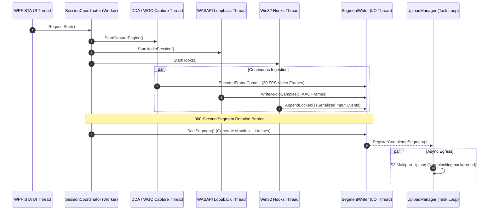

# System Architecture - Kuro Windows Desktop

> **Document:** `ARCHITECTURE.md`  
> **Source Target:** `KuroWindows.dll`, `ClientTelemetry.dll`, `DeviceIdentity.dll`, `SystemAudio.dll`, `DesktopUpdates.dll`  
> **Host Environment:** Windows 10/11 x86_64, .NET 8 Desktop Runtime

---

## 1. High-Level Architectural Pattern

Kuro employs a **hybrid decoupled desktop architecture**:
1. A **low-level C# / .NET 8 native host** managing hardware capture, direct OS hooks, DirectX graphics pipelines, audio loops, cryptographic attestation, local disk management, and background uploads.
2. A **hardened, sandboxed Chromium presentation layer** via Microsoft Edge WebView2, rendering HTML5/CSS/JavaScript with a strict Content Security Policy (`connect-src 'none'`).
3. An **asynchronous bi-directional IPC bridge (`CoreBridgeServer`)** executing strongly-typed JSON RPC over WebView2's native message port.
4. An **out-of-process isolation worker (`UiaProbeWorker`)** executing Windows UI Automation queries across an inter-process Named Pipe to prevent UI thread starvation or COM deadlocks.

```mermaid
flowchart TB
    subgraph OSBoundary["Windows Operating System"]
        Win32Hooks["Win32 Low-Level Hooks\n(WH_MOUSE_LL / WH_KEYBOARD_LL)"]
        DDA["DXGI Desktop Duplication API\n/ Windows.Graphics.Capture"]
        WASAPI["WASAPI Loopback Capture\n(IAudioClient / IAudioCaptureClient)"]
        TPM["TPM 2.0 / CNG\n(Microsoft Platform Crypto Provider)"]
        CredMgr["Windows Credential Manager\n/ DPAPI (CryptProtectData)"]
        UIA_OS["Windows UI Automation COM Tree"]
    end

    subgraph MainProcess["KuroWindows.exe (Main Process)"]
        direction TB
        AppMain["Program.Main / App.xaml.cs\n(STA Thread + Mutex Global\\KuroWindows_SingleInstance)"]
        
        subgraph CoreCoordinators["Coordinators & State Machines"]
            SessionCoord["SessionCoordinator\n(Idle, Recording, Paused, PrivacyPaused, LowDisk)"]
            ContentionMon["CaptureContentionMonitor\n(5s Process & Authenticode Scanner)"]
            PrivacyMgr["PrivacyManager\n(Sensitive App / Window / Password Masking)"]
            SyncMgr["DesktopSyncManager\n(Remote FeatureFlags & Policy Cache)"]
            UploadMgr["UploadManager\n(S3 Multipart / Single-Part Pipeline)"]
        end

        subgraph IngestionEngines["Hardware Ingestion Engines"]
            CapEngine["DisplayCapture / Gen2 GPU\n(Vortice D3D11 / TextureVideoEncoder)"]
            AudioEngine["SystemAudioSession\n(SampleRing + FDK-AAC Encoder)"]
            InputEngine["InputMonitor\n(Hook Thread + RawInput + PtpGestureMachine)"]
            UiaHost["UiaProbeHost\n(NamedPipeClient Dispatcher)"]
        end

        subgraph StorageEgress["Storage & Telemetry"]
            StorageMgr["StorageManager\n(%APPDATA%/Kuro/.data)"]
            ClientTelem["ClientTelemetry Engine\n(Batching, RingBuffer, UUIDv7)"]
        end

        subgraph HostIPC["IPC & WebView Container"]
            BridgeServer["CoreBridgeServer\n(JSON-RPC Request/Response + Broadcasts)"]
            ShellWin["ShellWindow.xaml.cs\n(WPF Window Host + Win32 Drag/Resize)"]
            WV2_Host["Microsoft.Web.WebView2 Control\n(VirtualHost: https://kuro-app.example/)"]
        end
    end

    subgraph SubprocessWorker["KuroWindows.exe --uia-probe (Worker Subprocess)"]
        ProbeWorker["UiaProbeWorker\n(MTA Thread + Parent PID Reaper)"]
    end

    subgraph RendererProcess["msedgewebview2.exe (Renderer Process)"]
        UI_DOM["index.html + styles.css + app.js\n(Vanilla JS MVC / 20 Design States)"]
        UI_Comm["communications.js\n(Bulletin & Guard Notice Engine)"]
    end

    %% Wiring
    Win32Hooks --> InputEngine
    DDA --> CapEngine
    WASAPI --> AudioEngine
    TPM <--> AppMain
    CredMgr <--> AppMain
    UIA_OS <--> ProbeWorker

    UiaHost <-->|Named Pipe: KuroWindowsUiaProbe-*| ProbeWorker
    
    CapEngine & AudioEngine & InputEngine --> StorageMgr
    StorageMgr --> UploadMgr
    
    SessionCoord --> CapEngine
    SessionCoord --> AudioEngine
    SessionCoord --> InputEngine
    SessionCoord --> StorageMgr
    
    ContentionMon --> SessionCoord
    PrivacyMgr --> SessionCoord
    SyncMgr --> SessionCoord
    
    BridgeServer <--> SessionCoord
    BridgeServer <--> UploadMgr
    BridgeServer <--> SyncMgr
    BridgeServer <--> ShellWin
    
    ShellWin --> WV2_Host
    WV2_Host <-->|window.chrome.webview.postMessage| UI_DOM
    UI_DOM --> UI_Comm
```

---

## 2. Multi-Process Architecture

Kuro enforces process boundaries to isolate unstable Windows subsystems and protect the user's desktop environment:

### 2.1 Process Matrix

| Process Name | Role | Arguments / Invocation | Privileges & Isolation |
| :--- | :--- | :--- | :--- |
| **`KuroWindows.exe`** | **Main Host Process** | Normal user launch or `--background` | Standard User; single instance enforced by named Mutex |
| **`KuroWindows.exe`** | **UIA Probe Worker** | `--uia-probe <PipeName> <ParentPid>` | Standard User; MTA thread; runs with disabled error UI |
| **`msedgewebview2.exe`** | **Browser Process** | Managed by WebView2 Runtime | Standard Chromium browser sandbox architecture |
| **`msedgewebview2.exe`** | **Renderer Process** | Managed by WebView2 Runtime | Sandboxed; restricted network (`connect-src 'none'`) |
| **`msedgewebview2.exe`** | **GPU Process** | Managed by WebView2 Runtime | Hardware-accelerated presentation rendering |

### 2.2 Out-of-Process UIA Isolation Rationale
Windows UI Automation (UIA) allows inspecting accessibility hierarchies of third-party desktop windows. However, querying COM interfaces on external applications can deadlock indefinitely or trigger access violations if the target application is hung or unresponsive.
- To prevent UI freezes or host termination, Kuro never invokes UIA directly on its main thread or recording thread.
- Instead, [`UiaProbeHost`](file:///d:/Kuro%20and%20Loggy3/extracted/lib/app/KuroWindows.dll) spawns `KuroWindows.exe --uia-probe <pipeName> <parentPid>`.
- The worker executes inside an MTA apartment, sets `SetErrorMode(SEM_FAILCRITICALERRORS | SEM_NOGPFAULTERRORBOX)`, and implements a parent-process watchdog (`StartParentReaper`) that self-terminates immediately if the parent dies.
- The parent queries the helper with strict execution deadlines (`UiaProbeBridgeDeadlineMs = 400ms`, `UiaProbeForegroundDeadlineMs = 750ms`). If the worker hangs, the pipe connection is aborted without disrupting video or input recording.

---

## 3. Threading & Concurrency Model

The main process runs a carefully isolated multi-threaded system where real-time hardware ingestion is never blocked by UI rendering, disk I/O, or network uploads:

### 3.1 Detailed Thread Inventory

1. **WPF STA Thread (`Dispatcher`):**
   - Owns `App.xaml`, `ShellWindow.xaml`, `System.Windows.Forms.NotifyIcon` (system tray).
   - Initializes WebView2, handles window dragging, resizing, minimizing, and tray icon animations.
2. **Session Coordinator Timer Threads (`ThreadPool`):**
   - Executes segment rotation timers (`RotateClipSeamlessly`, 300s).
   - Checks available disk space every 30 seconds (`CheckDiskSpace`).
   - Polls active application capabilities every 150ms/500ms (`CapabilityUsageMonitor`).
3. **Capture Worker Thread:**
   - Dedicated thread acquiring DXGI desktop frames (`AcquireNextFrame`) or handling `Windows.Graphics.Capture` frame pools.
   - Executes hardware color conversion (BGRA -> NV12) and hardware H.264 encode via MediaFoundation or Gen2 Direct3D11 shaders.
4. **Audio Ingestion Thread:**
   - Event-driven WASAPI capture thread (`IAudioClient.Initialize` with `AUDCLNT_STREAMFLAGS_LOOPBACK | AUDCLNT_STREAMFLAGS_EVENTCALLBACK`).
   - Reads 10ms audio buffers into a high-concurrency lock-free `SampleRing` buffer, feeding the native FDK-AAC encoder.
5. **Input Monitor Message Pump Thread:**
   - Runs a dedicated Win32 message loop (`GetMessage` / `DispatchMessage`) to receive `WH_MOUSE_LL` and `WH_KEYBOARD_LL` hook callbacks.
   - Flushes mouse motion vectors every 8ms (`MouseDeltaFlushMs`) to prevent message queue flooding while retaining fine trajectory fidelity.
6. **Upload Manager Worker Loop (`Task.Run`):**
   - Continuously sweeps completed segments from local disk.
   - Calculates SHA-256 digests, requests pre-signed URLs from Supabase Edge Functions, streams data to S3, and enforces local retention policies.

---

## 4. Inter-Process Communication (IPC)

Kuro features two distinct IPC channels:

### 4.1 Internal Host-to-Frontend IPC (`CoreBridge`)
- **Transport:** Native Chromium message port exposed via WebView2 (`window.chrome.webview.postMessage` and `CoreWebView2.WebMessageReceived`).
- **Protocol:** JSON-RPC 2.0-style messages containing `id`, `method`, and `params`.
- **Directionality:**
  - **Client to Host (Commands):** Requests such as `start_recording`, `stop_recording`, `get_dashboard`, `request_payout`.
  - **Host to Client (Snapshots & Events):** Automatic state broadcasts (`CoreBridgeSnapshot`) sent whenever recording status, disk space, upload progress, or auth state changes.

### 4.2 System & Subprocess IPC (Windows Named Pipes)
- **App Command Pipe (`\\.\pipe\KuroWindowsAppCommand`):** Used by second instances to forward commands (`show-settings`, `quit`) to the primary instance before exiting.
- **OAuth Callback Pipe (`\\.\pipe\KuroWindowsOAuthCallback`):** Receives authorization codes from `com.kuro.app://` protocol registrations or loopback HTTP listeners (`127.0.0.1:57391`).
- **UIA Probe Pipes (`\\.\pipe\KuroWindowsUiaProbe-<Guid>`):** Dedicated duplex binary pipes delivering structured accessibility queries and responses between `UiaProbeHost` and `UiaProbeWorker`.

---

## 5. Architectural Trade-offs & Decisions

| Decision | Selected Approach | Alternative Considered | Architectural Rationale |
| :--- | :--- | :--- | :--- |
| **UI Presentation Engine** | WPF + WebView2 | Pure WPF / WinUI 3 / Electron | Eliminates Chromium memory overhead by reusing Edge runtime; permits modern CSS/HTML design system; WPF provides rock-solid Win32 tray, window handles, and DirectX interop. |
| **Frontend Network Sandbox** | `connect-src 'none'` (CSP) | Direct frontend `fetch` / Axios | Total security isolation. The webview cannot leak sensitive tokens, credentials, or user data to external origins. All data egress passes through audited backend code. |
| **Audio Encoding** | Native `fdk-aac.dll` | Windows Media Foundation AAC | MediaFoundation AAC encoder has strict profile constraints and variable licensing on Windows N editions. Fraunhofer FDK AAC ensures consistent high-quality low-bitrate encoding on all machines. |
| **Video Recording Structure** | 5-Minute Rotated Segments | Continuous Monolithic Stream | Segment rotation ensures that sudden system reboots, crashes, or power outages lose at most a fraction of a 5-minute clip. Completed segments upload immediately in the background. |
| **Hardware Device Attestation** | TPM 2.0 Platform Crypto Provider | Machine GUID / MAC Address | Prevents bot farms, multi-accounting, and virtual machine spoofing by cryptographically signing device proofs with non-exportable hardware private keys. |
| **DNS Resolution** | Dual DoH Failover + Last-Good Cache | Standard OS `getaddrinfo` | Prevents recording or upload disruption caused by ISP DNS poisoning, ad blockers, corporate proxies, or local network resolver failures. |

