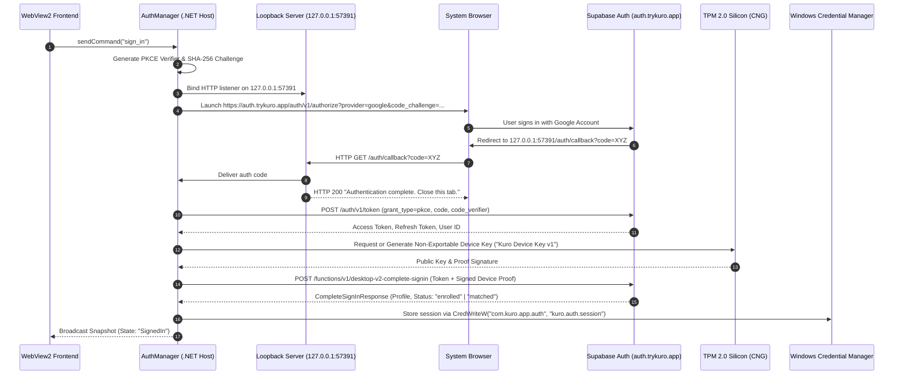
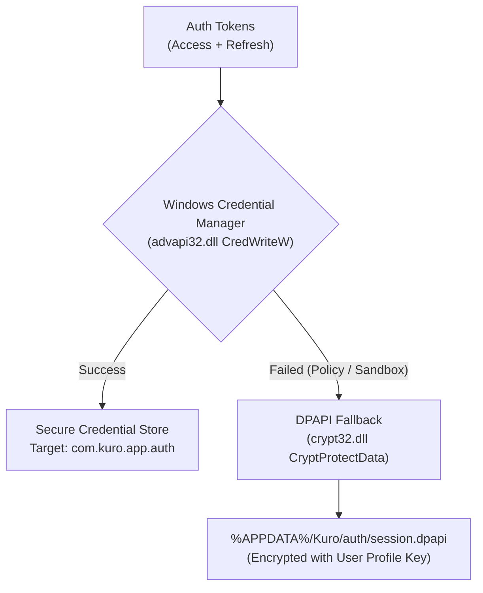

# Authentication, Cryptography & Security Architecture - Kuro Windows Desktop

> **Document:** `AUTHENTICATION_SECURITY.md`  
> **Source Target:** `KuroWindows.Auth/`, `DeviceIdentity.dll`, `KuroWindows.Input.Uia/`  
> **Security Standards:** OAuth 2.0 + PKCE (RFC 7636), TPM 2.0 Attestation (TCG), Windows CNG, DPAPI

---

## 1. Authentication Architecture

Kuro employs an enterprise-grade authentication pipeline combining Google OAuth 2.0 with PKCE and hardware-bound cryptographic device attestation:



---

## 2. Dual OAuth Callback Handling

To guarantee reliable callback delivery regardless of local firewall or browser configurations, Kuro implements a **dual-transport callback listener**:

### 2.1 Primary Channel: Loopback HTTP Server (`LoopbackOAuthCallbackServer.cs`)
- Binds to `http://127.0.0.1:57391/auth/callback`.
- Configured with a 5-minute timeout window.
- Renders a clean branded HTML page upon receipt, instructing the user to return to the Kuro desktop app.

### 2.2 Fallback Channel: Custom Protocol Handler (`OAuthCallbackServer.cs`)
- Registers `com.kuro.app` custom URI scheme in the Windows Registry under `HKCU\Software\Classes\com.kuro.app`.
- If loopback is blocked (e.g. by corporate VPN or aggressive firewalls), Supabase redirects to `com.kuro.app://callback?code=XYZ`.
- Windows launches `KuroWindows.exe --auth-callback <url>`.
- The second instance connects to named pipe `\\.\pipe\KuroWindowsOAuthCallback`, delivers the authorization code to the primary instance, and terminates.

---

## 3. Cryptographic Hardware Attestation (`DeviceIdentity.dll`)

Kuro binds contributor sessions to physical hardware silicon to defeat bot farms, emulator farms, and multi-accounting fraud.

### 3.1 TPM 2.0 Silicon Private Key (`DeviceKey.cs`)
- **Crypto Subsystem:** Windows Cryptography API: Next Generation (CNG / `ncrypt.dll`).
- **Provider:** `"Microsoft Platform Crypto Provider"` (Hardware TPM 2.0 chip).
- **Key Algorithms:**
  - Primary: **ECDSA P-256** (`Kuro Device Key v1`).
  - Fallback: **RSA 2048-bit** (`Kuro Device Key v1 RSA`) if elliptic curves are unsupported by legacy TPM firmware.
- **Hardware Isolation:** The private key is generated inside the TPM silicon and marked **non-exportable** (`NCRYPT_EXPORT_POLICY_PROPERTY = 0`). Private key operations occur exclusively within the hardware processor.

### 3.2 Signed Device Proof Headers (`DeviceProof.cs`)
Every authenticated API request transmits three verification headers:
- `x-device-key-id`: Unique cryptographic identifier of the enrolled device key.
- `x-device-ts`: Millisecond ISO 8601 UTC timestamp.
- `x-device-signature`: Cryptographic signature generated over the request payload.

#### Canonical Proof Signing String:
```
kuro-device-proof/v1
<x-device-key-id>
<x-device-ts>
<HTTP_METHOD>
<REQUEST_PATH>
<SHA256_HASH_OF_BODY>
```
If the timestamp deviates from server time by more than the accepted clock window, the request is rejected with `device_proof_invalid` (`clock`).

### 3.3 TPM Endorsement Certificate (EK) Validation (`TpmEndorsement.cs`)
To verify that the TPM is genuine physical silicon and not a software emulator:
1. Kuro extracts the Endorsement Certificate (EK Cert) from the TPM NVRAM (`0x01c00002`).
2. If absent from NVRAM, it queries the manufacturer's official Public Key Infrastructure:
   - **Intel Platform:** Queries Intel EKOP (`https://ekop.intel.com/ekcertservice/`).
   - **AMD Platform:** Queries AMD fTPM AIA (`https://ftpm.amd.com/pki/aia/`).
3. The certificate is DER-encoded and submitted to the cloud backend for X.509 root chain verification.

---

## 4. Hardware Fingerprinting & VM Detection (`HardwareFacets.cs`)

Kuro collects immutable hardware facets to evaluate contributor device integrity:

### 4.1 Physical Hardware Auditing
- **Motherboard UUID & Serial:** Extracted via WMI query `Win32_BaseBoard` and `Win32_ComputerSystemProduct.UUID`.
- **SMBIOS Serial:** Validates physical BIOS serial against system chassis.
- **Physical CPU & Core Counts:** Queries `Win32_Processor` and CPUID instruction registers.
- **GPU Device Identifiers:** DirectX DXGI adapter enumeration (`Vortice.DXGI`) extracting vendor ID, device ID, and dedicated video memory.

### 4.2 Virtual Machine & Cloud Detection
To prevent virtualized cloud instances (e.g. AWS/GCP/Azure) from running fake telemetry nodes:
- **CPUID Hypervisor Bit:** Executes CPUID with `EAX=1`, inspecting bit 31 of `ECX`. If set, a hypervisor is present.
- **Hypervisor Signature:** Queries CPUID leaf `0x40000000` to extract hypervisor vendor strings:
  - `"VMwareVMware"` (VMware)
  - `"VBoxVBoxVBox"` (VirtualBox)
  - `"Microsoft Hv"` (Hyper-V / Azure)
  - `"KVMKVMKVM\0\0\0"` (KVM / QEMU)
  - `"bhyve bhyve "` (FreeBSD bhyve)
- **Cloud Metadata Probe:** Attempts a 200ms ultra-low-timeout probe to known cloud link-local addresses (`169.254.169.254` for AWS/GCP/Azure/Oracle). If a response is received, the node is tagged as cloud infrastructure.

### 4.3 Remote Control Session Detection (`RemoteControlProbe.cs`)
- Checks Win32 `GetSystemMetrics(SM_REMOTESESSION)`.
- Inspects active Windows Terminal Services sessions via `wtsapi32.dll` (`WTSQuerySessionInformationW`).
- Detects running remote desktop utilities: RDP, TeamViewer, AnyDesk, Chrome Remote Desktop, VNC.

---

## 5. Local Credential Vault Security (`CredentialStore.cs`)

Authentication tokens are never persisted in plain files or browser local storage:



1. **Windows Credential Manager:** Primary store. Bound to user login credentials and stored in Windows Vault.
2. **DPAPI Fallback:** Secondary store. Encrypted via Win32 `CryptProtectData` with `CRYPTPROTECT_UI_FORBIDDEN`. The symmetric encryption key is derived by Windows from the user's password hash and machine GUID.

---

## 6. Process Integrity & Sandbox Defense

1. **Content Security Policy Sandbox:**
   The WebView2 presentation container is forbidden from executing outbound connections (`connect-src 'none'`), loading external scripts (`script-src 'self'`), or being embedded in frames (`frame-ancestors 'none'`).
2. **Process Integrity Level Auditing (`lowerIl`):**
   `InputMonitor` inspects the active foreground process token via `GetTokenInformation(TokenIntegrityLevel)`. Events targeting processes with integrity lower than medium (such as sandbox containers or untrusted processes) are tagged with `lowerIl: true` to prevent privilege confusion.
3. **Out-of-Process UIA Isolation:**
   By running UI Automation in a separate worker process (`--uia-probe`), malicious or malfunctioning third-party applications cannot compromise the main recording host or freeze its execution loops.

