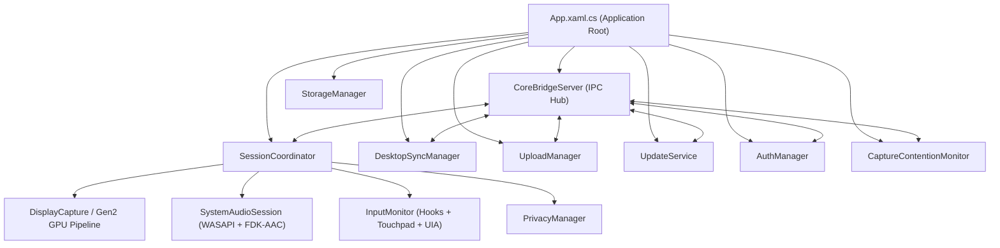

# Backend Architecture & Business Logic - Kuro Windows Desktop

> **Document:** `BACKEND_LOGIC.md`  
> **Source Target:** `KuroWindows/`, `ClientTelemetry/`, `DeviceIdentity/`, `SystemAudio/`, `DesktopUpdates/`  
> **Framework:** .NET 8.0 Windows Desktop (`net8.0-windows`)

---

## 1. Backend Service Landscape

The Kuro backend is structured into modular, decoupled service layers executing concurrently under the orchestration of [`App.xaml.cs`](file:///d:/Kuro%20and%20Loggy3/extracted/lib/app/KuroWindows.dll):



---

## 2. Session Coordinator (`SessionCoordinator.cs`)

[`SessionCoordinator`](file:///d:/Kuro%20and%20Loggy3/extracted/lib/app/KuroWindows.dll) is the central finite state machine controlling all hardware recording pipelines.

### 2.1 State Model (`SessionState`)

| State | Description | Ingestion Behavior |
| :--- | :--- | :--- |
| **`Idle`** | Initial state; application waiting for user start or background trigger | No hardware hooks, no video capture, no audio threads running |
| **`Recording`** | Normal operational capture state | GPU capturing at 30 FPS; WASAPI loopback encoding; input hooks active |
| **`Paused`** | Manually paused by user via toggle in dashboard | Ingestion threads suspended; active segment sealed |
| **`PrivacyPaused`** | Automatically suspended by `PrivacyManager` | Inserts blank video frames; input events suppressed; resume delayed by 1500ms debounce |
| **`LowDisk`** | Available disk space below safety threshold | Capture aborted immediately; forces upload flush to reclaim disk space |
| **`UpdateRequired`** | Client version falls below cloud `VersionFloor` | Recording blocked; prompts user to install staged update |

### 2.2 Segment Rotation Engine (`RotateClipSeamlessly`)
Recording does not produce an unbounded file. Instead, the coordinator enforces strict 300-second (5-minute) clips:
1. Every 300,000ms, the `_clipRotationTimer` fires on a threadpool worker.
2. The coordinator locks the active `SegmentSet`, records the final timestamp, and calls `SegmentSet.Rotate()`.
3. The detached segment's writers are sealed in a background task (`SealDetachedSegmentAsync`):
   - Computes SHA-256 cryptographic hashes for the MP4 video, audio M4A, events JSONL, and sidecar JSONL.
   - Emits `segment_<index>.manifest.json` and `metadata_<index>.json`.
   - Signals `UploadManager.TriggerUpload()`.
4. Simultaneously, new files for segment `index + 1` are created on disk without dropping a single video frame or audio packet.

---

## 3. High-Performance GPU Capture Engine (`KuroWindows.Capture`)

Kuro supports two distinct capture architectures to achieve universal compatibility across Intel, AMD, and NVIDIA hardware:

### 3.1 Architecture Comparison

| Feature | Legacy DDA (`DisplayCapture.cs`) | Next-Gen Gen2 (`GpuV2CaptureBackend.cs`) |
| :--- | :--- | :--- |
| **Underlying API** | DXGI 1.2 Desktop Duplication API | Windows.Graphics.Capture (WGC) + Direct3D11 |
| **DirectX Interop** | SharpGen / Vortice DXGI OutputDuplication | Windows Runtime Composition (`IDirect3DDevice`) |
| **Color Conversion** | CPU or basic D3D11 staging texture | GPU Pixel Shaders (`Gen2Shaders.cs`) Direct NV12 |
| **Mouse Cursor** | Software cursor composited via `CursorRenderer` | Hardware composited or zero-latency shader overlay |
| **Multi-Monitor** | Separate DDA instance per `IDXGIOutput` | Independent `GraphicsCaptureItem` per monitor |

### 3.2 Target Cadence Controller (`CaptureCadenceController.cs`)
- Fixed at **30.0 Frames Per Second** (`AppConfig.DefaultCaptureFramesPerSecond`).
- Implements high-precision pacing using Windows multimedia timers (`timeSetEvent`) and `Stopwatch` tick counts.
- Dynamically detects frame drops and duplicate frames, tagging sidecar records with `FramesDroppedSincePrev`.

---

## 4. Input Telemetry & Touchpad Processing (`KuroWindows.Input`)

[`InputMonitor`](file:///d:/Kuro%20and%20Loggy3/extracted/lib/app/KuroWindows.dll) captures user interactions with millisecond timestamping while enforcing strict safety controls:

### 4.1 Low-Level Win32 Hooks
- **Mouse Ingestion:** Installs `WH_MOUSE_LL` hook. Tracks cursor coordinates, buttons (Left, Right, Middle, XButton1, XButton2), scroll delta, and momentum phases. To prevent OS message pump starvation, mouse coordinate changes are coalesced into 8ms micro-batches (`MouseDeltaFlushMs`).
- **Keyboard Ingestion:** Installs `WH_KEYBOARD_LL` hook. Tracks virtual keys, scan codes, extended flags, and dead keys. Resolves physical keystrokes into characters using the active window's keyboard layout (`GetKeyboardLayout` + `ToUnicodeEx`).
- **Integrity Level Tracking:** Inspects process security tokens via `OpenProcessToken` and `GetSidSubAuthority` to detect if target windows run with elevated or lower integrity (`lowerIl`).

### 4.2 Precision Touchpad HID Engine (`KuroWindows.Input.Touchpad`)
Unlike standard mouse emulators, Kuro interfaces directly with physical Precision Touchpads (PTP):
1. **HID Report Descriptor Parsing (`PtpDevicePlan.cs`):** Enumerates raw HID digitizers, extracting contact identifiers, tip switch status, confidence bits, and sub-millimeter coordinates.
2. **Contact Frame Assembly (`PtpFrameAssembler.cs`):** Collects simultaneous multi-finger contacts into atomic time-synchronized `PtpFrame` records.
3. **Gesture State Machine (`PtpGestureMachine.cs`):** Recognizes real-time gestures:
   - Two-finger pan / inertia scroll
   - Pinch-to-zoom (distance delta between contact 0 and 1)
   - Multi-finger tap and swipe transitions

### 4.3 Out-of-Process UI Automation (`UiaProbeHost.cs`)
- Communicates with `KuroWindows.exe --uia-probe` via Named Pipes.
- Queries active controls for accessibility roles, bounding rectangles, control types, and password flags (`IsPassword`).
- Protects the recording pipeline from hangs with a strict 400ms timeout (`UiaProbeBridgeDeadlineMs`).

---

## 5. System Audio Ingestion Engine (`SystemAudio.dll`)

[`SystemAudioSession`](file:///d:/Kuro%20and%20Loggy3/extracted/lib/app/SystemAudio.dll) implements continuous loopback recording of desktop audio:

1. **WASAPI Loopback Capture:**
   - Initializes default multimedia playback endpoint (`IMMDeviceEnumerator.GetDefaultAudioEndpoint(eRender, eConsole)`).
   - Configures `IAudioClient` with `AUDCLNT_STREAMFLAGS_LOOPBACK` and event-driven buffers.
2. **Lock-Free Sample Ring Buffer (`SampleRing.cs`):**
   - High-throughput circular buffer decouples the real-time WASAPI callback thread from the audio compression pipeline.
3. **Fraunhofer FDK-AAC Compression (`AacEncoder.cs`):**
   - Interops directly with native `fdk-aac.dll` (`FdkAacInterop.cs`).
   - Configures High-Efficiency / Low-Complexity AAC (Audio Object Type 2 - LC), 48,000 Hz, stereo audio, 128 kbps bitrate.
   - Emits synchronized AAC frames into `audio.m4a` / `audio.mp4`.

---

## 6. Privacy & Contention Monitoring

### 6.1 Real-Time Privacy Masking (`PrivacyManager.cs`)
`PrivacyManager` continuously monitors the active user context:
- **Lock Screen Protection:** Detects `LockApp.exe` and `LogonUI.exe`; completely blinds video and drops input.
- **Self Protection:** Masks `KuroWindows.exe` window regions to avoid recursive visual feedback.
- **Password Detection:** Interrogates focused input fields; blinds recording whenever `CurrentIsPassword == true`.
- **Webcam & Mic Activity:** Monitors Windows privacy registry keys (`CapabilityAccessManager\ConsentStore\webcam`); triggers privacy pause when camera hardware is in use.
- **Policy Rules:** Synchronizes regex patterns from cloud for sensitive browser URLs and banking/financial window titles.

### 6.2 Capture Contention Scanner (`CaptureContentionMonitor.cs`)
To prevent interference or conflicts with third-party software, `CaptureContentionMonitor` executes an ongoing process audit:
1. Every 5,000ms, enumerates all running processes.
2. Extracts binary names, product names, original filenames, internal names, and Authenticode digital certificates (`X509Certificate`).
3. Hashes extracted attributes using SHA-256 and compares them against `DesktopMaskingPolicy.ContentionFingerprints`.
4. If a match is found, immediately triggers `IsContended = true`, pauses capture, and raises the ShellWindow.

---

## 7. Storage, Egress & Cloud Sync

### 7.1 Local Storage Hierarchy (`StorageManager.cs`)
All recording artifacts reside in a hidden directory in the user profile:
```
%APPDATA%\Kuro\
├── .data\                                 (Hidden Storage Root)
│   ├── yyyy-MM-dd_HH-mm-ss\               (Session Directory)
│   │   ├── .active-session.json           (Session state recovery marker)
│   │   ├── clip_0.mp4                     (Display 0 H.264 Video)
│   │   ├── events_0.jsonl                 (Display 0 Input Events)
│   │   ├── frame_timestamps_0.jsonl       (Display 0 Frame Sidecar)
│   │   ├── audio.m4a                      (System Audio Loopback)
│   │   ├── segment_0.manifest.json        (Cryptographic Manifest)
│   │   └── metadata_0.json                (Device & Session Facts)
├── auth\
│   └── session.dpapi                      (Fallback encrypted session)
├── desktop_config.json                    (Cached Cloud Feature Flags)
└── settings.json                          (User Preferences)
```

### 7.2 Upload Manager Pipeline (`UploadManager.cs`)
- **Discovery Sweep:** Constantly scans `.data\` for sealed segments containing valid `.manifest.json` files.
- **Negotiation:** Sends file list and SHA-256 digests to `desktop-v2-upload-request`.
- **Egress:**
  - Files `< 100 MB`: Uploaded via HTTP `PUT` to pre-signed S3 URLs.
  - Files `≥ 100 MB`: Chunked into 10 MB parts, uploaded in parallel via S3 Multipart Upload, and committed with `desktop-v2-upload-multipart-complete`.
- **Retention:** Upon successful cloud confirmation, local video files are purged to conserve user disk space.

### 7.3 Desktop Configuration Sync (`DesktopSyncManager.cs`)
- Periodically calls `desktop-v2-sync` to poll updated feature flags, video bitrates, and masking rules.
- Serializes active configurations to `desktop_config.json` to allow offline seeding on next boot.

