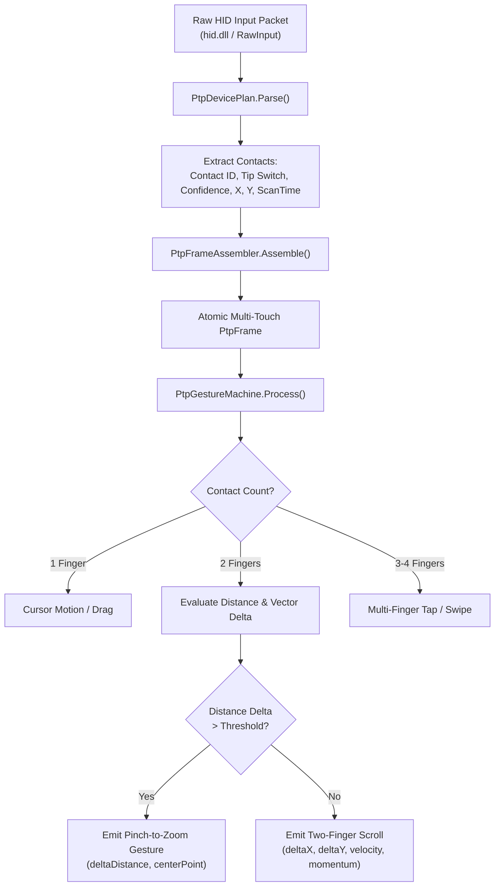
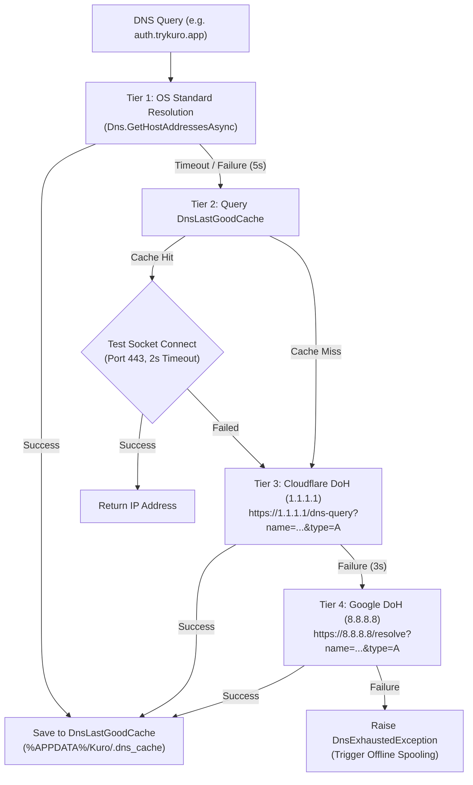

# Core Algorithms & Implementation Mechanics - Kuro Windows Desktop

> **Document:** `CORE_ALGORITHMS.md`  
> **Source Target:** `KuroWindows.Input.Touchpad/`, `KuroWindows.Capture/`, `KuroWindows.Net/`, `ClientTelemetry/UuidV7.cs`

---

## 1. Precision Touchpad (PTP) HID & Gesture Recognition

Kuro implements a complete hardware HID digitizer parser and multi-finger gesture recognition engine in [`KuroWindows.Input.Touchpad`](file:///d:/Kuro%20and%20Loggy3/extracted/lib/app/KuroWindows.dll):



### 1.1 Mathematical Formulation of Gesture Detection

#### 1. Pinch-to-Zoom Calculation:
Given two contacts $C_0(x_0, y_0)$ and $C_1(x_1, y_1)$ at frame $t$, the inter-contact distance $D_t$ is:
$$D_t = \sqrt{(x_1 - x_0)^2 + (y_1 - y_0)^2}$$
The zoom scale factor $\Delta Z$ relative to previous frame $t-1$ is:
$$\Delta Z = \frac{D_t}{D_{t-1}}$$
If $|\Delta Z - 1.0| > \epsilon_{\text{pinch}}$ (where $\epsilon_{\text{pinch}} = 0.02$), a pinch zoom event is dispatched with center coordinate:
$$C_{\text{center}} = \left(\frac{x_0 + x_1}{2}, \frac{y_0 + y_1}{2}\right)$$

#### 2. Inertial Scroll Velocity & Momentum:
When two fingers lift off the touchpad, the engine computes instantaneous release velocity:
$$V_x = \frac{\Delta x}{\Delta t}, \quad V_y = \frac{\Delta y}{\Delta t}$$
If $\|V\| > V_{\text{min}}$, momentum scroll phases are generated using exponential decay:
$$V(t) = V_0 \cdot e^{-\lambda t}$$

---

## 2. Capture Cadence & Video Bitrate Policy

High-fidelity desktop video recording requires balancing CPU/GPU utilization, encoder queue health, and file size.

### 2.1 Cadence Controller (`CaptureCadenceController.cs`)
- **Target Frame Period:** $\tau = \frac{1000}{30.0} \approx 33.333\text{ ms}$.
- **Monotonic Clock:** High-resolution QPC (QueryPerformanceCounter) converts raw CPU ticks to nanoseconds ($PTS_{\text{ns}}$).
- **Frame Drop Classification:**
  If an acquired frame arrives at $T_{\text{actual}}$ such that:
  $$\Delta T = T_{\text{actual}} - T_{\text{prev}} > 1.8 \cdot \tau$$
  The controller calculates dropped frame count:
  $$\text{FramesDropped} = \left\lfloor \frac{\Delta T}{\tau} \right\rfloor - 1$$
  and logs the dropped interval to the frame sidecar.

### 2.2 Adaptive Bitrate Policy (`VideoBitratePolicy.cs`)
The video encoder bitrate is scaled dynamically based on monitor resolution and topology:

$$\text{Bitrate}_{\text{target}} = \text{BaseBitrate} \times \left( \frac{\text{Width} \times \text{Height}}{1920 \times 1080} \right)^{0.75} \times \text{DisplayScalingFactor}$$

- Standard 1080p: **2,500 kbps**
- 1440p (2K): **3,800 kbps**
- 2160p (4K): **7,200 kbps**
- Encoder stalls (`CaptureEncoderStallException`) trigger temporary 25% bitrate reductions until encoder queues recover.

---

## 3. Resilient Multi-Tier DNS Failover Algorithm

Kuro guarantees cloud connectivity in environments with broken or censored local DNS via [`DnsFallbackResolver.cs`](file:///d:/Kuro%20and%20Loggy3/extracted/lib/app/KuroWindows.dll):



1. **Tier 1 (OS Resolver):** 5-second timeout.
2. **Tier 2 (Last-Good Cache):** Instant local disk lookup. Validates socket connectivity before accepting stale IPs.
3. **Tier 3 (Cloudflare DoH):** Direct HTTPS query to `1.1.1.1` bypassing local DNS servers.
4. **Tier 4 (Google DoH):** Direct HTTPS query to `8.8.8.8`.

---

## 4. Process Contention Fingerprint Hashing

[`CaptureContentionMonitor`](file:///d:/Kuro%20and%20Loggy3/extracted/lib/app/KuroWindows.dll) identifies competing screen recorders or conflicting software without relying solely on easily spoofed process filenames:

### 4.1 Attribute Extraction Pipeline
For every running process $P$, the monitor extracts 7 normalized string fields:
```
F1 = Lowercase(FileName)
F2 = Lowercase(ProductName)
F3 = Lowercase(OriginalFilename)
F4 = Lowercase(InternalName)
F5 = Lowercase(FileDescription)
F6 = Lowercase(CompanyName)
F7 = Lowercase(AuthenticodeSignerCommonName)
```

### 4.2 Cryptographic Digest Matching
For each non-empty field $F_i$, it computes the SHA-256 digest:
$$H_i = \text{SHA-256}(F_i)$$
The monitor then evaluates set intersection:
$$\text{IsContended} = \bigcup_{i=1}^7 \{H_i\} \cap \text{PolicyBlockedHashes} \neq \emptyset$$

This ensures that renaming `obs64.exe` to `svchost.exe` fails to bypass detection, as its internal product name, original filename, and digital certificate signer remain identical.

---

## 5. Monotonic UUIDv7 Generation (`UuidV7.cs`)

Telemetry batches require globally unique, time-ordered identifiers to facilitate efficient indexing and deduplication in cloud databases:

```
 0                   1                   2                   3
 0 1 2 3 4 5 6 7 8 9 0 1 2 3 4 5 6 7 8 9 0 1 2 3 4 5 6 7 8 9 0 1
+-+-+-+-+-+-+-+-+-+-+-+-+-+-+-+-+-+-+-+-+-+-+-+-+-+-+-+-+-+-+-+-+
|                           unix_ts_ms                          |
+-+-+-+-+-+-+-+-+-+-+-+-+-+-+-+-+-+-+-+-+-+-+-+-+-+-+-+-+-+-+-+-+
|          unix_ts_ms           |  ver  |       rand_a          |
+-+-+-+-+-+-+-+-+-+-+-+-+-+-+-+-+-+-+-+-+-+-+-+-+-+-+-+-+-+-+-+-+
|var|                        rand_b                             |
+-+-+-+-+-+-+-+-+-+-+-+-+-+-+-+-+-+-+-+-+-+-+-+-+-+-+-+-+-+-+-+-+
|                            rand_b                             |
+-+-+-+-+-+-+-+-+-+-+-+-+-+-+-+-+-+-+-+-+-+-+-+-+-+-+-+-+-+-+-+-+
```

1. **`unix_ts_ms` (48 bits):** High-precision millisecond UTC timestamp.
2. **`ver` (4 bits):** Fixed value `0111` (UUID version 7).
3. **`rand_a` (12 bits):** Sub-millisecond monotonic sequence counter. Prevents clock collisions if multiple records generate within the same millisecond.
4. **`var` (2 bits):** Fixed value `10` (RFC 4122 variant).
5. **`rand_b` (62 bits):** Cryptographically secure pseudo-random entropy from `RandomNumberGenerator`.

