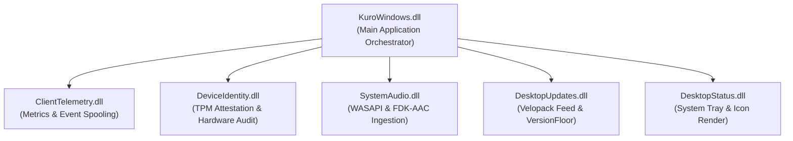

# Dependency & Assembly Analysis - Kuro Windows Desktop

> **Document:** `DEPENDENCIES.md`  
> **Source Target:** `KuroWindows.deps.json`, `KuroWindows.runtimeconfig.json`, `extracted/lib/app/`

---

## 1. Runtime Frameworks

Kuro targets **.NET 8.0 Windows Desktop** and ships as a self-contained / framework-dependent hybrid package powered by Velopack:

| Framework | Version | Assembly Reference | Description |
| :--- | :--- | :--- | :--- |
| **`Microsoft.NETCore.App`** | `8.0.32` | `coreclr.dll`, `clrjit.dll`, `clrgc.dll` | Modern .NET Core runtime and garbage collector |
| **`Microsoft.WindowsDesktop.App`**| `8.0.32` | `PresentationFramework.dll`, `System.Windows.Forms.dll` | Windows Presentation Foundation (WPF) and Windows Forms |
| **`Microsoft.Web.WebView2`** | Evergreen | `Microsoft.Web.WebView2.Core.dll`, `WebView2Loader.dll` | Chromium rendering engine via Microsoft Edge |

---

## 2. First-Party Application Assemblies

The application logic is partitioned into 6 specialized modular assemblies:

### Assembly Breakdown

| Assembly | Size | Primary Responsibility |
| :--- | :--- | :--- |
| **`KuroWindows.dll`** | `1,974,592 B` | Host WPF application, `SessionCoordinator`, DXGI/WGC capture engines, `InputMonitor`, `PrivacyManager`, `UploadManager`, `CoreBridgeServer`. |
| **`ClientTelemetry.dll`** | `124,224 B` | Real-time event batching, UUIDv7 generation, high-frequency counters, on-disk ring buffer spooling, AWS API Gateway egress. |
| **`DeviceIdentity.dll`** | `119,616 B` | TPM 2.0 CNG hardware key generation, device proof signing (`kuro-device-proof/v1`), EK cert retrieval, SMBIOS hardware facet auditing. |
| **`SystemAudio.dll`** | `100,672 B` | WASAPI loopback capture, lock-free `SampleRing` buffering, native Fraunhofer FDK-AAC compression orchestration. |
| **`DesktopUpdates.dll`** | `79,680 B` | Background update polling from `updates.trykuro.app`, package staging, mandatory cloud version floor checking (`VersionFloor`). |
| **`DesktopStatus.dll`** | `26,944 B` | Windows Notification Area (system tray) icon integration, tray animations, and status badge management. |

---

## 3. Third-Party Managed NuGet Dependencies

Kuro incorporates select high-performance open-source libraries:

### 3.1 DirectX & Graphics Bindings (Vortice & SharpGen)
- **`Vortice.Direct3D11.dll` (`367,936 B`):** Managed bindings for Direct3D 11 devices, device contexts, swapchains, and 2D textures.
- **`Vortice.DXGI.dll` (`119,104 B`):** Direct bindings for DXGI 1.2 Desktop Duplication API (`IDXGIOutputDuplication`).
- **`Vortice.MediaFoundation.dll` (`539,968 B`):** Hardware MFT H.264 video encoding pipeline.
- **`Vortice.Mathematics.dll` (`143,168 B`):** SIMD-accelerated vectors, matrices, and color representations.
- **`SharpGen.Runtime.dll` (`95,552 B`) & `SharpGen.Runtime.COM.dll` (`184,640 B`):** Zero-overhead C#/COM code generation interop framework powering Vortice.

### 3.2 Packaging & Update Management
- **`Velopack.dll` (`280,384 B`):** Cross-platform auto-update and installation framework. Manages silent background delta updates.
- **`NuGet.Versioning.dll` (`64,568 B`):** Semantic versioning (`SemVer 2.0`) parsing and evaluation.

### 3.3 WinRT Interop & Modern Windows APIs
- **`Microsoft.Windows.SDK.NET.dll` (`26,086,944 B`):** C#/WinRT projections enabling modern Windows 10/11 APIs (e.g. `Windows.Graphics.Capture`).
- **`WinRT.Runtime.dll` (`528,944 B`):** Low-level WinRT runtime activation and marshaling engine.

---

## 4. Bundled Native Dynamic Link Libraries (C/C++)

To avoid external runtime dependencies or missing system codecs, native binaries are bundled directly with the application:

| Native DLL | Size | Purpose & Functionality |
| :--- | :--- | :--- |
| **`fdk-aac.dll`** | `1,753,408 B` | Standalone Fraunhofer FDK AAC audio encoder. Provides high-fidelity low-bitrate AAC-LC compression directly via native C exports (`aacEncOpen`, `aacEncEncode`). |
| **`WebView2Loader.dll`** | `160,320 B` | Microsoft Edge WebView2 native bootstrapper; locates and binds to the system-installed Evergreen Edge runtime. |
| **`msquic.dll`** | `537,400 B` | Microsoft QUIC library. Powers modern HTTP/3 and QUIC resilient network transports. |
| **`D3DCompiler_47_cor3.dll`** | `4,741,488 B` | Microsoft Direct3D shader compiler runtime used for compiling HLSL shaders. |
| **`wpfgfx_cor3.dll`** | `1,956,136 B` | Native graphics composition engine for Windows Presentation Foundation. |
| **`PresentationNative_cor3.dll`** | `1,234,768 B` | Native Win32 support library for WPF input and window messaging. |
| **`coreclr.dll`** | `4,995,880 B` | Microsoft .NET 8 CoreCLR execution engine. |
| **`clrjit.dll`** | `1,777,960 B` | Microsoft .NET 8 RyuJIT Just-In-Time compiler. |
| **`clrgc.dll`** | `667,944 B` | Microsoft .NET 8 high-performance Garbage Collector. |

---

## 5. Operating System Win32 API Bindings (P/Invoke)

Kuro interfaces directly with core Windows operating system libraries:

| Windows System DLL | Bound APIs | Usage in Kuro |
| :--- | :--- | :--- |
| **`advapi32.dll`** | `CredWriteW`, `CredReadW`, `CredDeleteW`, `OpenProcessToken`, `GetTokenInformation`, `GetSidSubAuthority` | Windows Credential Manager storage; Process Integrity Level (`lowerIl`) auditing |
| **`crypt32.dll`** | `CryptProtectData`, `CryptUnprotectData` | DPAPI user-profile symmetric data protection |
| **`ncrypt.dll`** | `NCryptOpenStorageProvider`, `NCryptCreatePersistedKey`, `NCryptSignHash` | TPM 2.0 Platform Crypto Provider hardware key management |
| **`user32.dll`** | `SetWindowsHookExW`, `GetMessageW`, `DispatchMessageW`, `GetForegroundWindow`, `SetWinEventHook`, `AddClipboardFormatListener`, `ToUnicodeEx`, `GetKeyboardLayout`, `SendMessageW` | Low-level input interception, focus changes, clipboard events, borderless window drag |
| **`kernel32.dll`** | `CreateNamedPipeW`, `ConnectNamedPipe`, `GetDiskFreeSpaceExW`, `QueryFullProcessImageNameW`, `SetErrorMode` | IPC Named Pipes, disk space monitoring, process scanning, WER crash configuration |
| **`hid.dll`** | `HidD_GetPreparsedData`, `HidP_GetCaps`, `HidP_GetValueCaps` | Precision Touchpad raw HID digitizer descriptor parsing |
| **`dwmapi.dll`** | `DwmGetWindowAttribute` | Desktop Window Manager window cloaking and border inspection |

