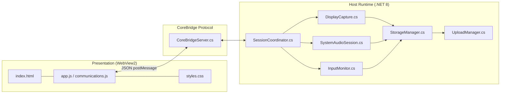

# Development, Debugging & Extension Guide - Kuro Windows Desktop

> **Document:** `DEVELOPMENT_GUIDE.md`  
> **Source Target:** Complete Solution (`KuroWindows.sln` / 6 Subsystem Projects)  
> **Prerequisites:** Windows 10/11 x64, .NET 8.0 SDK, Visual Studio 2022 / VS Code, Edge WebView2 Runtime

---

## 1. Architectural Mental Model

Before modifying or extending Kuro, developers must understand its multi-tiered lifecycle:



- **Zero-Network UI:** The UI has no network access (`connect-src 'none'`). Never write `fetch()` or `XMLHttpRequest` in frontend JavaScript. All backend communications must be implemented as a CoreBridge method in `CoreBridgeServer.cs`.
- **Segmented Storage:** Never stream data directly to remote servers. All video, audio, and events write to disk in 300-second immutable segments. Uploads are strictly performed by `UploadManager` after segment sealing.
- **Thread Isolation:** Hardware capture threads must never execute blocking UI operations, synchronous disk writes, or remote HTTP requests.

---

## 2. Workspace & Building the Project

### 2.1 Project Directory Structure
```
kuro/windows/src/
├── KuroWindows/               # Main WPF Host application & Coordinators
├── ClientTelemetry/           # Telemetry batching, UUIDv7, AWS Ingest client
├── DeviceIdentity/            # TPM 2.0 attestation, SMBIOS facet auditing
├── SystemAudio/               # WASAPI loopback capture & FDK-AAC wrapper
├── DesktopUpdates/            # Velopack auto-updater & VersionFloor client
└── DesktopStatus/             # Windows Notification Area (system tray) icon
```

### 2.2 Compilation via .NET CLI
To build the solution in Release configuration for 64-bit Windows:

```powershell
# Restore dependencies and build entire solution
dotnet build KuroWindows.sln -c Release -r win-x64 --no-self-contained

# Publish self-contained executable package
dotnet publish KuroWindows\KuroWindows.csproj -c Release -r win-x64 --self-contained -o bin\publish
```

### 2.3 Packaging with Velopack
To package the published binaries into an auto-updating installer:
```powershell
vpk pack `
    --packId "KuroWindows" `
    --packVersion "1.1.19" `
    --packDir "bin\publish" `
    --mainExe "KuroWindows.exe" `
    --outputDir "bin\dist" `
    --channel "win"
```

---

## 3. Local Debugging & Diagnostic Flags

Configure environment variables to simulate cloud states and inspect runtime diagnostics:

```powershell
# 1. Enable verbose GPU and Direct3D texture logging
$env:KURO_CAPTURE_DEBUG = "1"

# 2. Redirect Supabase calls to a local emulator instance
$env:KURO_SUPABASE_URL = "http://localhost:54321"

# 3. Disable custom URL scheme fallback (forces loopback HTTP auth testing)
$env:KURO_ENABLE_CUSTOM_SCHEME_FALLBACK = "0"

# 4. Accelerate peripheral capability checks (100ms)
$env:KURO_CAPABILITY_PRIVACY_POLL_MS = "100"

# 5. Launch Kuro in debug mode
.\bin\publish\KuroWindows.exe
```

---

## 4. Testing CoreBridge IPC Commands

Developers can interrogate or control the running application directly from the WebView2 DevTools Console.

### 4.1 Unlocking Developer Tools
By default, `app.js` suppresses the right-click context menu:
```javascript
// Temporarily comment out lines 87-90 in ui/app.js:
// document.addEventListener('contextmenu', (event) => event.preventDefault());
```
Press `F12` or `Ctrl + Shift + I` inside the Kuro window to open Microsoft Edge Developer Tools.

### 4.2 Interactive Console Probing
Execute commands directly in the console:

```javascript
// Query current system snapshot
await sendCommand('get_snapshot');

// Manually trigger recording start
await sendCommand('start_recording');

// Manually pause recording and trigger segment rotation
await sendCommand('stop_recording');

// Force immediate remote configuration sync
await sendCommand('request_sync');

// Trigger upload sweep of local segments
await sendCommand('retry_uploads');

// Fetch dashboard earnings metrics
await sendCommand('get_dashboard', { time_zone: 'America/New_York' });
```

---

## 5. Inspecting Local Recording Artifacts

All recording data is saved in a hidden folder within the user's `AppData` directory:

```powershell
# Unhide local recording directory for inspection
attrib -h "$env:APPDATA\Kuro\.data"

# Open directory in Windows File Explorer
explorer "$env:APPDATA\Kuro\.data"
```

### 5.1 Verifying JSON Lines Input Streams
Use Python or `jq` to inspect captured input events:

```powershell
# Stream mouse coordinates from the latest segment
Get-Content "$env:APPDATA\Kuro\.data\*\events_0.jsonl" -Tail 20 | ConvertFrom-Json | Select-Object timestamp, channel, x, y, appName
```

### 5.2 Video & Audio Playback
- Open `clip_0.mp4` in **VLC Media Player** or **ffplay**.
- Verify audio stream synchronization by playing `audio.m4a` concurrently:
  ```powershell
  ffplay -i clip_0.mp4 -vf "drawtext=fontfile=Arial.ttf: text='%{pts\:hms}': x=10: y=10: fontsize=24: fontcolor=white"
  ```

---

## 6. Common Troubleshooting Scenarios

### 6.1 Black Screen / Blank Frames During Capture
- **Root Cause:** Target window is running on Windows Secure Desktop (e.g. UAC confirmation prompt) or contains DRM-protected surfaces (e.g. protected video player).
- **Behavior:** `CaptureAccessDeniedClassifier` catches `DXGI_ERROR_ACCESS_LOST` or `E_ACCESSDENIED` and delivers synthetic black frames to prevent application crash.
- **Verification:** Inspect log for:
  ```
  [CAPTURE] Capture access denied; entering hold
  ```

### 6.2 Dual-GPU Laptop Device Mismatch
- **Issue:** On laptops with hybrid graphics (Intel Integrated + NVIDIA Discrete), Desktop Duplication must run on the GPU physically wired to the display outputs.
- **Resolution:** Kuro's `DxgiDisplayResolver` iterates adapters via DXGI 1.2 to bind the correct Direct3D device. If DDA fails, verify that Windows Graphics Settings has not forced `KuroWindows.exe` onto an unattached adapter.

### 6.3 TPM Attestation Failures
- **Issue:** `DeviceCheckException: device_key_mismatch` during sign-in.
- **Resolution:** If testing on a Virtual Machine without virtual TPM 2.0 enabled, `DeviceKey.cs` falls back to software simulation or RSA keys. Ensure TPM 2.0 pass-through is configured in your hypervisor (e.g. Hyper-V "Enable Trusted Platform Module").

### 6.4 UI Automation Helper Hangs
- **Issue:** Third-party application UI thread freezes, causing UIA queries to stall.
- **Resolution:** `UiaProbeHost` will abort the query after 400ms (`UiaProbeBridgeDeadlineMs`). If the helper process hangs completely, the main host terminates `KuroWindows.exe --uia-probe` and spawns a fresh worker instance.

---

## 7. Extension Guidelines

### 7.1 Adding a New CoreBridge Command
1. Define the method name in [`CoreBridgeServer.cs`](file:///d:/Kuro%20and%20Loggy3/extracted/lib/app/KuroWindows.dll#L163) `switch (request.Method.ToLowerInvariant())`:
   ```csharp
   case "custom_action":
       return await ExecuteCustomActionAsync(request.Params, cancellationToken);
   ```
2. Implement validation and business logic in the coordinator.
3. Expose the JavaScript call in `ui/app.js`:
   ```javascript
   async function customAction(param1) {
       return await sendCommand('custom_action', { param1 });
   }
   ```

### 7.2 Adding a New Privacy Mask
1. Open [`DesktopMaskingPolicy.cs`](file:///d:/Kuro%20and%20Loggy3/extracted/lib/app/KuroWindows.dll).
2. Append target executable names or regex patterns to `BlockedApps` or `SensitiveBrowserTitleKeywords`.
3. The change takes effect immediately via `PrivacyManager.Prime()`.

