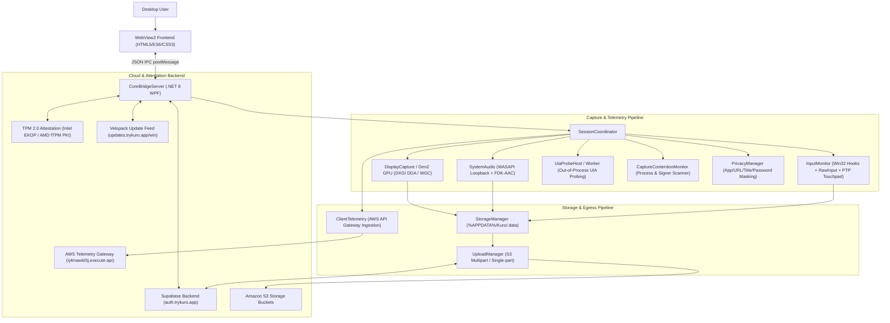

# Kuro Windows Desktop Application - Technical Blueprint & Documentation

> **Status:** Fully Reverse-Engineered & Documented  
> **Target Version:** 1.1.19.0 (Target Framework: `.NETCoreApp,Version=v8.0`, Architecture: `win-x64`)  
> **Internal Project Identity:** `markov-screen-recorder-tool` / `KuroWindows`  
> **Binary Packaging:** Velopack Installer (`KuroWindows-win-Setup.exe` with NuGet nuspec payload)  
> **Documentation Root:** Repository Root

---

## 1. Application Overview

**Kuro** is a high-performance Windows desktop telemetry, screen recording, input analysis, and contributor-reward platform. The desktop client captures continuous desktop activity—high-frame-rate display video, system audio, millisecond-accurate mouse/keyboard/touch interactions, window focus transitions, and accessibility trees—in secure, fated segments (nominally 300 seconds each). These segments are packaged with cryptographically verifiable manifests and hardware-attested metadata, and uploaded to Amazon S3 via Supabase Edge Function orchestration.

Contributors running Kuro earn platform rewards and telemetry credits based on their verified recording activity, display count, and session fidelity, while an active privacy and contention engine automatically blinds or suspends capture whenever sensitive windows, password fields, webcams, or competing screen recorders are detected.



---

## 2. Core Capabilities & Feature Matrix

| Capability | Implementation Mechanism | Location in Codebase |
| :--- | :--- | :--- |
| **GPU Video Capture** | DXGI Desktop Duplication API (DDA) + Windows.Graphics.Capture (WGC) + Gen2 Direct3D11 Texture Video Encoder | [`KuroWindows.Capture`](file:///d:/Kuro%20and%20Loggy3/extracted/lib/app/KuroWindows.dll) |
| **System Audio Capture** | WASAPI loopback capture with Fraunhofer FDK-AAC native encoding (`fdk-aac.dll`) | [`SystemAudio.dll`](file:///d:/Kuro%20and%20Loggy3/extracted/lib/app/SystemAudio.dll) |
| **Input Telemetry** | Low-level Win32 hooks (`WH_MOUSE_LL`, `WH_KEYBOARD_LL`), clipboard events, window focus hooks, process integrity checks | [`KuroWindows.Input`](file:///d:/Kuro%20and%20Loggy3/extracted/lib/app/KuroWindows.dll) |
| **Precision Touchpad** | Raw HID parser for Digitizer usage page (0x0D), contact tracker, and multi-finger gesture recognition | [`KuroWindows.Input.Touchpad`](file:///d:/Kuro%20and%20Loggy3/extracted/lib/app/KuroWindows.dll) |
| **UI Automation Probing** | Out-of-process UIA worker process (`--uia-probe`) over Named Pipes to isolate COM hangs/crashes | [`KuroWindows.Input.Uia`](file:///d:/Kuro%20and%20Loggy3/extracted/lib/app/KuroWindows.dll) |
| **Privacy & Masking** | Dynamic detection of password fields, webcams, lock screen, sensitive browser titles, and blocked processes | [`PrivacyManager`](file:///d:/Kuro%20and%20Loggy3/extracted/lib/app/KuroWindows.dll) |
| **Contention Monitoring** | Background scanning of running executables, company names, Authenticode signatures, and hash matching | [`CaptureContentionMonitor`](file:///d:/Kuro%20and%20Loggy3/extracted/lib/app/KuroWindows.dll) |
| **Hardware Attestation** | TPM 2.0 key generation via Microsoft Platform Crypto Provider, Intel EKOP / AMD fTPM EK certificates | [`DeviceIdentity.dll`](file:///d:/Kuro%20and%20Loggy3/extracted/lib/app/DeviceIdentity.dll) |
| **Resilient Networking** | Cloudflare (`1.1.1.1`) and Google (`8.8.8.8`) DNS-over-HTTPS (DoH) failover with Last-Good IP caching | [`KuroWindows.Net`](file:///d:/Kuro%20and%20Loggy3/extracted/lib/app/KuroWindows.dll) |
| **Desktop Dashboard UI** | Microsoft Edge WebView2 hosting a zero-network CSP sandboxed HTML5/ES6 application communicating via CoreBridge | [`ui/`](file:///d:/Kuro%20and%20Loggy3/extracted/lib/app/ui) |
| **Automated Updates** | Velopack background update staging, mandatory version floor enforcement (`VersionFloor`) | [`DesktopUpdates.dll`](file:///d:/Kuro%20and%20Loggy3/extracted/lib/app/DesktopUpdates.dll) |

---

## 3. Technology Stack & Architectural Inventory

### 3.1 Host & Frameworks
- **Host Runtime:** Microsoft .NET 8.0 Windows Desktop App (`net8.0-windows`)
- **UI Presentation Layer:** WPF (`System.Windows`) host container + Microsoft.Web.WebView2 (`1.0.x`)
- **Frontend Stack:** Vanilla ES6+ JavaScript, Semantic HTML5, CSS3 Custom Properties (Variables), zero third-party external runtime JS frameworks.
- **Installer & Packaging:** Velopack (`VelopackApp`) packaging NuGet packages (`.nupkg`) inside self-extracting stub executables (`KuroWindows_ExecutionStub.exe`).

### 3.2 Native Interop & Graphics
- **DirectX & Graphics:** `Vortice.Direct3D11`, `Vortice.DXGI`, `Vortice.MediaFoundation`, `Vortice.Mathematics`, `SharpGen.Runtime`.
- **Audio Codec:** Native Fraunhofer FDK AAC library (`fdk-aac.dll`).
- **Security & Crypto:** Windows CNG (`ncrypt.dll`), CryptoAPI (`crypt32.dll`), Windows Credential Manager (`advapi32.dll`).
- **Win32 APIs:** `user32.dll` (hooks, windows, clipboard), `kernel32.dll` (named pipes, memory, WER), `hid.dll` (touchpad HID packets).

---

## 4. Documentation Directory Structure

This documentation suite provides deep technical visibility into every aspect of the Kuro Windows application:

| Document | Purpose |
| :--- | :--- |
| **[`ARCHITECTURE.md`](ARCHITECTURE.md)** | Complete multi-process architecture, IPC models, thread pools, and subsystem diagrams. |
| **[`APPLICATION_FLOW.md`](APPLICATION_FLOW.md)** | Step-by-step lifecycle execution flows: boot, authentication, capture, rotation, shutdown. |
| **[`FRONTEND_LOGIC.md`](FRONTEND_LOGIC.md)** | WebView2 UI architecture, 20 design states, render loop, communications bulletin system. |
| **[`BACKEND_LOGIC.md`](BACKEND_LOGIC.md)** | Detailed implementation analysis of all .NET services, coordinators, and state machines. |
| **[`API_REFERENCE.md`](API_REFERENCE.md)** | Complete catalog of CoreBridge IPC commands, ShellWindow methods, and Cloud Edge Functions. |
| **[`DATABASE_SCHEMA.md`](DATABASE_SCHEMA.md)** | File formats, segment manifests, sidecars, event schemas (45 fields), and credential stores. |
| **[`AUTHENTICATION_SECURITY.md`](AUTHENTICATION_SECURITY.md)** | OAuth PKCE, TPM 2.0 attestation, signed device proofs, DPAPI, and CSP sandboxing. |
| **[`SECURITY_AND_PRIVACY_AUDIT.md`](SECURITY_AND_PRIVACY_AUDIT.md)** | Comprehensive audit of file system access, privacy leak risks, vulnerabilities, and safety verdict. |
| **[`BUGS.md`](BUGS.md)** | Exhaustive code-level audit of confirmed software bugs, race conditions, memory/handle leaks, and failure scenarios. |
| **[`INTEGRATIONS.md`](INTEGRATIONS.md)** | External cloud services (Supabase, AWS S3/API Gateway), TPM PKI authorities, native DLLs. |
| **[`CORE_ALGORITHMS.md`](CORE_ALGORITHMS.md)** | Precision Touchpad gesture machine, DoH failover, adaptive bitrates, contention hashing. |
| **[`CONFIGURATION.md`](CONFIGURATION.md)** | Complete listing of environment variables, registry entries, timeouts, and cache keys. |
| **[`ERROR_HANDLING.md`](ERROR_HANDLING.md)** | WER crash mini-dumps, post-crash recovery, upload retries, and WebView2 health repair. |
| **[`DEPENDENCIES.md`](DEPENDENCIES.md)** | Exhaustive assembly, native DLL, and package catalog with security and licensing notes. |
| **[`DEVELOPMENT_GUIDE.md`](DEVELOPMENT_GUIDE.md)** | Instructions for building, debugging, testing, extending, and inspecting the codebase. |

---

## 5. Quick Setup & Execution

### 5.1 Prerequisites
- **Operating System:** Windows 10 (Build 19041+) or Windows 11 (x64)
- **Runtime Dependencies:**
  - Microsoft Edge WebView2 Runtime (Evergreen)
  - DirectX 11 capable GPU (Hardware feature level 11.0+)
  - Optional: TPM 2.0 silicon (for hardware device key enrollment; software fallback available)

### 5.2 Launch Modes
1. **Interactive UI Launch:**
   ```powershell
   .\KuroWindows.exe
   ```
   Opens the borderless WPF shell hosting the WebView2 dashboard in `solo` mode (`600x400`) or `dashboard` mode (`800x600`).
2. **Background Headless Launch (Startup / Tray):**
   ```powershell
   .\KuroWindows.exe --background
   ```
   Launches silently to the system notification tray, verifies single-instance ownership, and begins recording if already signed in and consented.
3. **UI Automation Helper Worker (Internal Process):**
   ```powershell
   .\KuroWindows.exe --uia-probe <PipeName> <ParentPid>
   ```
   Invoked by the main application to execute accessibility queries without risking COM deadlocks.
4. **OAuth Protocol Callback (Protocol Handler):**
   ```powershell
   .\KuroWindows.exe --auth-callback <com.kuro.app://callback-url>
   ```
   Forwards OAuth authorization code to the active running instance via named pipe `KuroWindowsOAuthCallback` and immediately exits.

