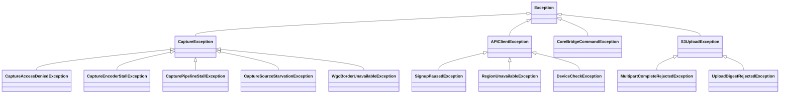
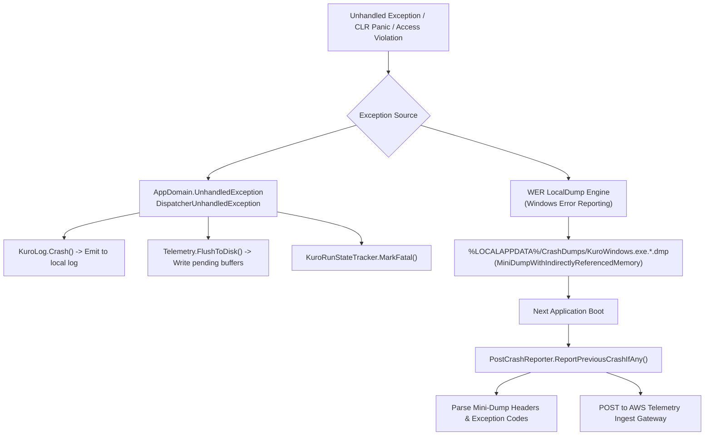
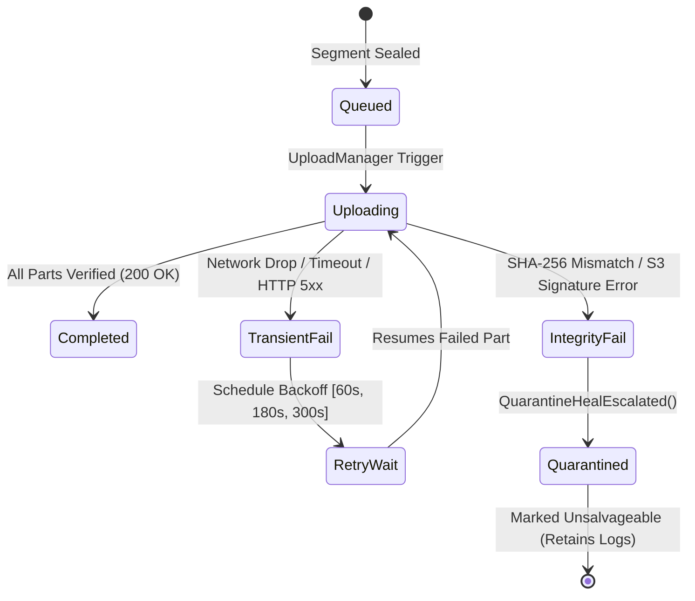

# Error Handling, Diagnostics & Recovery Architecture - Kuro Windows Desktop

> **Document:** `ERROR_HANDLING.md`  
> **Source Target:** `KuroWindows.Diagnostics/`, `KuroWindows.Storage/InterruptedSessionRecovery.cs`, `KuroWindows.Upload/UploadFailurePolicy.cs`, `KuroWindows.Capture/`

---

## 1. Exception Hierarchy & Classification

Kuro classifies exceptions into domain-specific hierarchies to drive automatic recovery workflows:



### 1.1 Capture Exceptions & Classifiers

| Exception Class | Root Cause | Recovery Strategy |
| :--- | :--- | :--- |
| **`CaptureAccessDeniedException`** | Windows Secure Desktop active (UAC dialog, Winlogon screen, DRM protected window) | [`CaptureDeniedHold`](file:///d:/Kuro%20and%20Loggy3/extracted/lib/app/KuroWindows.dll) suspends capture loop; delivers black frames; rechecks every 1.0s until access is restored |
| **`DuplicationSlotContention`** | Another application holds exclusive access to DXGI Desktop Duplication API | Backs off according to `CaptureRetryDelaysSeconds = [3s, 3s, 3s, 10s, 30s, 60s]`; reinitializes DDA adapter |
| **`CaptureEncoderStallException`** | Hardware video encoder (NVENC / QuickSync / AMF) fails to consume input frames | Reinitializes DirectX 11 device context; falls back to CPU encoding or throttles bitrate by 25% |
| **`CaptureSourceStarvationException`** | Display output stops generating frame swap events (e.g. monitor entering sleep mode) | Enters standby; pauses frame sidecar timestamps until display wakes |

---

## 2. Crash Diagnostics & WER Mini-Dumps

Kuro implements a multi-tier crash capture system to ensure forensic logs are preserved even if the CLR suffers an unrecoverable failure:



### 2.1 Mini-Dump Registry Configuration (`CrashDiagnostics.ConfigureWerLocalDumps`)
Configures the Windows Error Reporting service to write crash dumps locally without displaying disruptive Windows crash dialogs:
- **Registry Key:** `HKCU\Software\Microsoft\Windows\Windows Error Reporting\LocalDumps\KuroWindows.exe`
- **`DumpFolder`:** `%LOCALAPPDATA%\CrashDumps`
- **`DumpType`:** `1` (`MiniDumpNormal` - thread stacks and loaded module lists)
- **`DumpCount`:** `3` (prevents disk bloat by retaining only the 3 most recent dumps)

### 2.2 Post-Crash Forensic Reporting (`PostCrashReporter.cs`)
Upon subsequent startup, Kuro executes an automated post-mortem investigation:
1. Scans `%LOCALAPPDATA%\CrashDumps` for `.dmp` files matching `KuroWindows.exe.*`.
2. Uses native Win32 `DbgHelp.dll` APIs (`MiniDumpReadDumpStream`) to extract:
   - Faulting Exception Code (e.g. `0xC0000005` Access Violation, `0xE0434352` CLR Exception)
   - Faulting Thread Call Stack and Instruction Pointer (`RIP`/`EIP`)
   - Crashing native or managed module name and file offset
3. Dispatches a high-priority telemetry record to the cloud ingest gateway and archives the dump file.

---

## 3. Interrupted Session Recovery (`InterruptedSessionRecovery.cs`)

When the operating system suffers a sudden power loss, blue screen (BSOD), or forced termination, Kuro's segment-based storage guarantees data salvage:

1. **Active Heartbeat Marker:** During normal recording, `StorageManager` maintains an active heartbeat file:
   ```
   %APPDATA%\Kuro\.data\<session_dir>\.active-session.json
   ```
   containing `segmentIndex` and `updatedAtUtc`.
2. **Cold Boot Scan:** On startup, `InterruptedSessionRecovery.Recover()` checks for dangling sessions where `.active-session.json` exists without a matching `segment_<index>.manifest.json`.
3. **Artifact Salvage:**
   - Scans directory for intact `clip_<d>.mp4`, `events_<d>.jsonl`, and `frame_timestamps_<d>.jsonl` files.
   - Computes SHA-256 hashes of all recovered files.
   - Generates a synthetic manifest tagged with:
     ```json
     { "fate": "recovered_from_crash" }
     ```
   - Deletes `.active-session.json`.
4. **Queue for Upload:** Marks the recovered segment as eligible for upload. The user loses only the final few seconds of recording rather than the entire multi-hour session.

---

## 4. Upload Failure & Retry Pipeline (`UploadFailurePolicy.cs`)

Network instability during high-volume media egress is handled with exponential backoff and resumable chunking:



1. **Transient Backoff Intervals:** Retries execute after progressive delays: 60 seconds, 180 seconds, and 300 seconds.
2. **Multipart Part Resumption:** If an upload fails during a 150 MB video transfer, already committed 10 MB parts are not re-uploaded; only failed or missing parts are re-requested.
3. **Quarantine & Poison File Isolation:** If an artifact repeatedly fails SHA-256 validation (`UploadDigestRejectedException`), it is moved to a quarantine state to prevent infinite retry loops from starving healthy segments.

---

## 5. WebView2 Health Monitoring & Auto-Repair (`WebView2Health.cs`)

Because the presentation layer relies on an external Chromium runtime, Kuro implements dedicated health probes to recover from browser crashes:

### 5.1 Runtime Process Failure (`CoreWebView2_ProcessFailed`)
- **Browser Exit / GPU Crash:** Intercepts `ProcessFailedEventArgs`.
- If the renderer crashes or hangs, [`ShellWindow.xaml.cs`](file:///d:/Kuro%20and%20Loggy3/extracted/lib/app/KuroWindows.dll#L104) attempts an immediate in-memory reload:
  - Allowed maximum **3 consecutive reload attempts** (`MaxRendererReloadAttempts = 3`).
  - Resets reload counter if the UI runs stably for more than 60 seconds.

### 5.2 Runtime Corruption Auto-Repair
If WebView2 fails to instantiate during application startup:
1. Displays fallback native Win32 message: `"Fixing a Windows component Kuro needs. This can take a few minutes…"`.
2. Inspects alternative user data directory (`_useAltUserDataDir`).
3. If user data corruption is detected, recreates the WebView2 environment using a clean directory profile `%LOCALAPPDATA%\Kuro\WebView2_Alt`.

