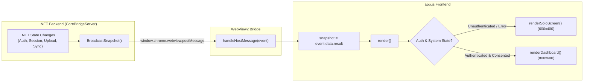
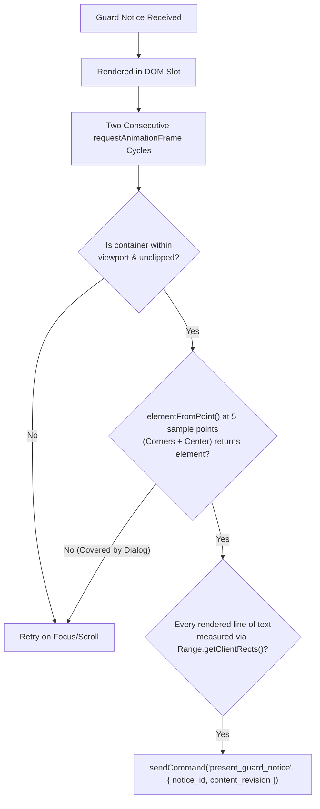

# Frontend Architecture & UI Logic - Kuro Windows Desktop

> **Document:** `FRONTEND_LOGIC.md`  
> **Source Directory:** `d:\Kuro and Loggy3\extracted\lib\app\ui/`  
> **Key Files:** [`index.html`](file:///d:/Kuro%20and%20Loggy3/extracted/lib/app/ui/index.html), [`app.js`](file:///d:/Kuro%20and%20Loggy3/extracted/lib/app/ui/app.js), [`communications.js`](file:///d:/Kuro%20and%20Loggy3/extracted/lib/app/ui/communications.js), [`styles.css`](file:///d:/Kuro%20and%20Loggy3/extracted/lib/app/ui/styles.css), [`colors_and_type.css`](file:///d:/Kuro%20and%20Loggy3/extracted/lib/app/ui/colors_and_type.css)

---

## 1. Overview & Security Sandbox

The Kuro frontend is hosted inside Microsoft Edge WebView2, rendering locally from the application installation directory. The UI relies entirely on vanilla modern JavaScript (ES6+), Semantic HTML5, and CSS3 variables—deliberately avoiding heavy JS frameworks (React/Vue/Angular) to achieve instant boot times, tiny memory footprint, and deterministic rendering.

### 1.1 Strict Content Security Policy (CSP)

The frontend enforces an impenetrable Content Security Policy via [`<meta>` tag in `index.html`](file:///d:/Kuro%20and%20Loggy3/extracted/lib/app/ui/index.html#L5):

```html
<meta http-equiv="Content-Security-Policy" content="
    default-src 'none'; 
    script-src 'self'; 
    style-src 'self' 'unsafe-inline'; 
    img-src 'self' data:; 
    font-src 'self'; 
    connect-src 'none'; 
    base-uri 'none'; 
    form-action 'none'; 
    frame-ancestors 'none'; 
    object-src 'none'
" />
```

> [!IMPORTANT]
> **Total Network Isolation (`connect-src 'none'`):** The WebView2 engine is blocked by the browser sandbox from issuing **any** network requests (`fetch`, `XMLHttpRequest`, `WebSocket`, `EventSource`). The frontend cannot communicate with the outside world directly. All network telemetry, authentication, dashboard data, and payout requests **must** pass through the .NET `CoreBridge` via `window.chrome.webview.postMessage`.

### 1.2 Virtual Host Mapping

Instead of loading through insecure `file://` URIs, [`ShellWindow.xaml.cs`](file:///d:/Kuro%20and%20Loggy3/extracted/lib/app/KuroWindows.dll) maps the local `ui/` directory to a custom HTTPS virtual domain:
- **Virtual Host Domain:** `https://kuro-app.example/`
- **Entry URI:** `https://kuro-app.example/index.html`
- **Mapping Call:** `CoreWebView2.SetVirtualHostNameToFolderMapping("kuro-app.example", uiDir, CoreWebView2HostResourceAccessKind.Allow)`

---

## 2. State Synchronization via CoreBridge

Frontend state is driven by a single reactive unidirectional data loop powered by `CoreBridgeSnapshot`:



### 2.1 The Request/Response Promise Bridge

Commands sent to the WPF backend use a unique message counter and a Map of pending Promise resolvers:

```javascript
const pendingHostRequests = new Map();
let nextHostRequestId = 1;

function sendHostRequest(method, params = null) {
    const id = nextHostRequestId++;
    return new Promise((resolve, reject) => {
        pendingHostRequests.set(id, { resolve, reject, method });
        window.chrome.webview.postMessage({ id, method, params });
    });
}

function handleHostMessage(event) {
    const message = event.data;
    if (message.type === 'response') {
        const pending = pendingHostRequests.get(message.id);
        if (pending) {
            pendingHostRequests.delete(message.id);
            if (message.ok) pending.resolve(message.result);
            else pending.reject(new Error(message.error?.message || 'Command failed'));
        }
    } else if (message.type === 'event' && message.event === 'core_bridge_snapshot') {
        snapshot = message.data;
        render();
    }
}
```

---

## 3. Window Layout Modes & Resizing

Kuro adjusts the physical OS window dimensions depending on the active state:

| Window Mode | Resolution | Triggering States | Implementation in `ShellWindow` |
| :--- | :--- | :--- | :--- |
| **`solo`** | **`600 x 400` px** | Welcome, Signing In, Consent Review, Suspensions, Contention, Updating | Removes sidebar; centers content; clamps to monitor work area |
| **`dashboard`** | **`800 x 600` px** | Main authenticated dashboard (`account`, `earnings`, `referrals`, `permissions`) | Displays 2-column grid: 200px sidebar + flex content area |

When transitioning between modes, `app.js` issues `sendCommand('resize_window', { width, height })`, which invokes Win32 `SetWindowPos` without causing visual frame flicker.

---

## 4. The 20 Design States (`DESIGN_STATE_COVERAGE`)

`app.js` explicitly defines 20 discrete visual states (`DESIGN_STATE_COVERAGE`) to cover every lifecycle and error scenario:

### 4.1 Onboarding & Authentication States
1. **`01_welcome`:** Initial state for unauthenticated users. Shows Kuro brand icon, title "Earn rewards for desktop telemetry", and the Google Sign-In CTA button.
2. **`02_signing_in`:** Active after clicking sign-in. Shows an animated spinning loader, subtext "Complete sign-in in your default browser...", and a "Cancel" button.
3. **`03_review_agree`:** Displayed after Google OAuth callback succeeds. Presents legal terms review:
   - Checkbox 1: Terms of Service (`tos`) and Privacy Policy (`privacy_policy`) consent.
   - Checkbox 2: Legal age confirmation ("I confirm that I am at least 18 years old").
   - CTA: "Agree & Continue" (disabled until both checkboxes are ticked).
4. **`04_all_set`:** Ephemeral onboarding completion screen before transitioning into the main dashboard.
5. **`05_restoring`:** Displayed on cold start when stored credentials (`kuro.auth.session`) are being decrypted and validated against Supabase.
6. **`06_sign_in_error`:** Displays error pill if OAuth callback fails, times out, or receives an invalid PKCE token.

### 4.2 System Denial & Restriction States
7. **`signup_paused`:** Triggered when the cloud backend sets `signups_enabled: false`. Informs the user that registration is temporarily closed.
8. **`region_unavailable`:** Triggered if IP geolocation restricts participation in the user's country or state.
9. **`08_device_suspended`:** Device hardware fingerprint or TPM key has been blacklisted by platform fraud detection.
10. **`09_account_suspended`:** User account has been deactivated for terms violations.
11. **`10_device_linked`:** The current physical device is already bound to a different Google account. Prompts the user to log in with the original account.
12. **`11_update_required`:** Client version is below the mandatory cloud floor (`VersionFloor`). Displays "Update Required" with a direct "Update Now" button.
13. **`12_privacy_paused`:** Informational indicator that recording is suspended due to active privacy masks.
14. **`13_tray_menu_removed`:** Educational notification explaining that controls have moved to the dashboard.
15. **`14_capture_contention`:** High-priority warning screen shown when another screen recording utility (OBS, Camtasia, Fraps, GameBar) or conflicting capture session is detected.

### 4.3 Runtime Dashboard Views (`runtime_dashboard`)
16. **`account` (Default View):**
    - User Identity Card: Display name, email, and user crest avatar (colored using `CREST_PALETTE` via email string hash).
    - Recording Master Switch: Big toggle button switching between `start_recording` and `stop_recording`.
    - Telemetry Status Grid: Frame rate (FPS), audio status, upload queue metrics, local disk usage.
    - System Settings: "Launch at startup" toggle, "Dark / Light" theme selector, "Sign out" and "Quit" buttons.
17. **`earnings`:**
    - Recorded Today Metric: Hours/minutes captured today.
    - Hourly & Daily Earnings Rates: Dynamic payout metrics calculated from active telemetry tiers.
    - Payout Button: Launches `payout_dialog`.
    - Daily Activity & Transaction Pager: Table listing past recordings, accepted hours, and credits earned.
18. **`referrals`:**
    - Referral Link Card: Copy-to-clipboard referral URL (`https://trykuro.app/r/<code>`).
    - Referral Stats: Total invites, active referrals, referral bonus earnings.
19. **`permissions`:**
    - System permission checklist: Screen Recording (DDA/WGC), System Audio Capture, UI Automation Helper status.
20. **`payout_dialog`:**
    - Modal dialog allowing users to enter a payout destination (e.g. PayPal address, crypto wallet) and submit `request_payout`.

---

## 5. Communications Bulletin & Guard Notice Engine (`communications.js`)

[`communications.js`](file:///d:/Kuro%20and%20Loggy3/extracted/lib/app/ui/communications.js) implements a strict **verifiable presentation system** for broadcast messages and compliance warnings:

### 5.1 Presentation Verification Algorithm (`fullyVisible`)
The platform requires legal certainty that a user actually viewed a required notice (e.g. policy changes, security warnings) before considering it "delivered". A notice is NOT acknowledged merely by being returned in JSON:



1. **Two-Frame Settling:** Notice must survive two consecutive `requestAnimationFrame` cycles to ensure layout stabilization.
2. **Clipping & Viewport Bounds:** Checks `getBoundingClientRect()` against all scrolling parent elements and the main window bounds.
3. **Element-From-Point Raycasting:** Casts 5 test rays (top-left, top-right, bottom-left, bottom-right, center). If any point is obscured by another dialog or overlay, presentation is refused.
4. **Rendered Line Verification:** Uses `document.createRange().getClientRects()` to verify that text lines are neither wrapped out of view nor clipped by text overflow.
5. **Host Delivery Receipt:** Only when all conditions pass does the frontend send `present_guard_notice` to the backend, which logs the compliance receipt to cloud telemetry.

---

## 6. Theming & Styling System

The user interface supports seamless Light and Dark modes configured via CSS Custom Properties in [`colors_and_type.css`](file:///d:/Kuro%20and%20Loggy3/extracted/lib/app/ui/colors_and_type.css) and [`styles.css`](file:///d:/Kuro%20and%20Loggy3/extracted/lib/app/ui/styles.css):

```css
:root {
    --ts-surface: #ffffff;
    --ts-ink: #0a0a0a;
    --ts-on-ink: #ffffff;
    --status-good: #16a34a;
    --status-warn: #d97706;
    --status-bad: #dc2626;
    --font-sans: 'Outfit', -apple-system, BlinkMacSystemFont, sans-serif;
    --font-display: 'Satoshi', var(--font-sans);
    --font-mono: 'GeistMono', monospace;
}

[data-theme="dark"] {
    --ts-surface: #131210;
    --ts-ink: #f5f5f5;
    --ts-on-ink: #0a0a0a;
}
```

- When the theme changes in the settings tab, `app.js` sets `document.documentElement.dataset.theme = theme` and informs the backend via `set_theme`.
- The WPF window host immediately updates its background brush to match `DarkSurface = Color.FromRgb(19, 18, 16)`, preventing white flashing during resize or startup.

