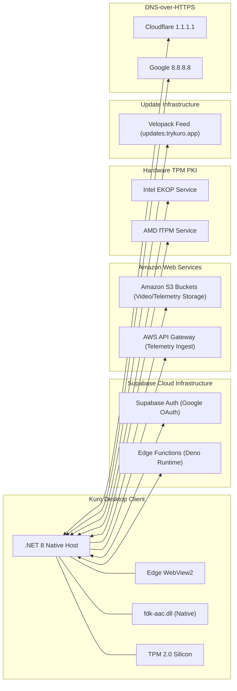

# Third-Party Integrations & External Services - Kuro Windows Desktop

> **Document:** `INTEGRATIONS.md`  
> **Source Target:** `AppConfig.cs`, `APIClient.cs`, `UpdateService.cs`, `SystemAudio/FdkAacInterop.cs`, `DnsFallbackResolver.cs`, `S3Uploader.cs`

---

## 1. Cloud & Third-Party Architecture Map

Kuro coordinates with a network of cloud infrastructure, native subsystems, hardware PKI authorities, and fallback services:

---

## 2. Supabase Integration (`https://auth.trykuro.app`)

Supabase acts as the control plane for user authentication, device attestation, configuration sync, and upload authorization.

| Edge Function | Endpoint URL | Purpose |
| :--- | :--- | :--- |
| **`desktop-v2-check-version`** | `/functions/v1/desktop-v2-check-version` | Enforces mandatory client version floor (`VersionFloor`) |
| **`desktop-v2-complete-signin`** | `/functions/v1/desktop-v2-complete-signin` | Exchanges PKCE authorization codes; validates initial device attestation |
| **`desktop-v2-register-device`** | `/functions/v1/desktop-v2-register-device` | Registers TPM public key, EK cert, and hardware SMBIOS facets |
| **`desktop-v2-sync`** | `/functions/v1/desktop-v2-sync` | Synchronizes dynamic feature flags, video bitrates, and masking lists |
| **`desktop-v2-upload-request`** | `/functions/v1/desktop-v2-upload-request` | Requests pre-signed S3 URLs or multipart upload part URLs |
| **`desktop-v2-upload-complete`** | `/functions/v1/desktop-v2-upload-complete` | Confirms single-part upload completion and validates SHA-256 |
| **`desktop-v2-upload-multipart-complete`** | `/functions/v1/desktop-v2-upload-multipart-complete` | Assembles S3 multipart upload with ordered ETag manifests |
| **`desktop-dashboard`** | `/functions/v1/desktop-dashboard` | RPC router for dashboard stats, history, referrals, and payouts |

---

## 3. Amazon Web Services (AWS)

Kuro leverages AWS infrastructure for high-bandwidth media storage and real-time operational telemetry:

### 3.1 Amazon S3 Storage Pipeline (`S3Uploader.cs`)
All recorded segments are pushed directly to Amazon S3 buckets via pre-signed URLs generated by Supabase:
- **Small Artifacts (`< 100 MB`):** Uploaded via standard HTTP `PUT` requests streaming from disk via [`ProgressStreamContent`](file:///d:/Kuro%20and%20Loggy3/extracted/lib/app/KuroWindows.dll).
- **Large Video Streams (`≥ 100 MB`):** Uploaded via **S3 Multipart Upload**:
  - Chunks: Sliced into fixed 10 MB parts (`RangedProgressStreamContent`).
  - Concurrency: Multiple parts uploaded in parallel with progress tracking.
  - Finalization: Each part's HTTP response `ETag` is collected and committed via `desktop-v2-upload-multipart-complete`.

### 3.2 Telemetry Ingest Gateway (`ClientTelemetry.dll`)
- **Endpoint:** `https://rj4mawk0tj.execute-api.us-east-1.amazonaws.com/v1/batches`
- **Mechanism:** Background task loop batches client operational events (UUIDv7 IDs, timing quality metrics, frame drop counts, crash stack traces).
- **Resilience:** Employs an on-disk ring buffer (`Writer.cs`) to ensure telemetry is never lost during offline periods.

---

## 4. Microsoft Edge WebView2

Kuro embeds Microsoft Edge WebView2 (`Microsoft.Web.WebView2.Wpf.dll`, `WebView2Loader.dll`) to render its dashboard:
- **Zero-Network CSP:** Configured with `connect-src 'none'`.
- **Virtual Host Domain:** Maps the local `ui/` directory to `https://kuro-app.example/` via `SetVirtualHostNameToFolderMapping`.
- **Self-Healing Health Probe (`WebView2Health.cs`):** Probes WebView2 runtime installation health on startup. If corrupted or missing, triggers background repair or instructs the user to reinstall the runtime.

---

## 5. DirectX & Windows Media Foundation (Vortice)

Kuro uses the Vortice Windows SDK wrappers to execute GPU hardware operations:
- **`Vortice.DXGI`:** Enumerates physical displays (`IDXGIOutput`), handles DDA desktop duplication (`IDXGIOutputDuplication`).
- **`Vortice.Direct3D11`:** Allocates texture swapchains, executes GPU texture copying and format conversion (BGRA to NV12).
- **`Vortice.MediaFoundation`:** Configures hardware-accelerated H.264 video encoding via Windows Media Foundation MFT transforms.

---

## 6. Fraunhofer FDK-AAC Native Library (`fdk-aac.dll`)

Kuro bundles the native Fraunhofer FDK AAC library (`fdk-aac.dll`) to ensure universal, high-quality audio compression:
- **P/Invoke Interop:** [`SystemAudio/FdkAacInterop.cs`](file:///d:/Kuro%20and%20Loggy3/extracted/lib/app/SystemAudio.dll) binds directly to:
  - `aacEncOpen`: Allocates an encoder instance with stereo configuration.
  - `aacEncoder_SetParam`: Sets AAC-LC profile (`AOT_AAC_LC = 2`), sample rate (48,000 Hz), bit rate (128,000 bps).
  - `aacEncEncode`: Encodes PCM audio buffers into raw AAC access units.
  - `aacEncClose`: Destroys native encoder handle.

---

## 7. Velopack Application Lifecycle & Auto-Updater

Kuro distributes updates through the modern **Velopack** packaging platform:
- **Update Feed:** `https://updates.trykuro.app/win`
- **Execution Stub:** `KuroWindows_ExecutionStub.exe` arbitrates binary updates and replaces assemblies in place without requiring administrative elevation.
- **Background Checks (`UpdateService.cs`):** Periodically polls the feed, stages delta updates (`.nupkg`), and applies them cleanly upon application restart or user approval.

---

## 8. Hardware TPM PKI Authorities

To validate genuine TPM 2.0 silicon during device enrollment, Kuro interfaces with silicon manufacturer PKI services:
- **Intel EKOP (Endorsement Key Online Protocol):** `https://ekop.intel.com/ekcertservice/`
- **AMD fTPM AIA Service:** `https://ftpm.amd.com/pki/aia/`
- Validates that the TPM Endorsement Key (EK) public key was signed by Intel or AMD root certificate authorities.

---

## 9. DNS-over-HTTPS (DoH) Failover Resolvers

To guarantee cloud connectivity in restricted or DNS-poisoned network environments, [`DnsFallbackResolver.cs`](file:///d:/Kuro%20and%20Loggy3/extracted/lib/app/KuroWindows.dll) integrates two DoH providers:
1. **Cloudflare DoH:** `https://1.1.1.1/dns-query?name={0}&type=A`
2. **Google Public DNS DoH:** `https://8.8.8.8/resolve?name={0}&type=A`
3. **Last-Good IP Cache (`DnsLastGoodCache.cs`):** Remembers successful IP mappings on local disk to survive complete DNS outages.

