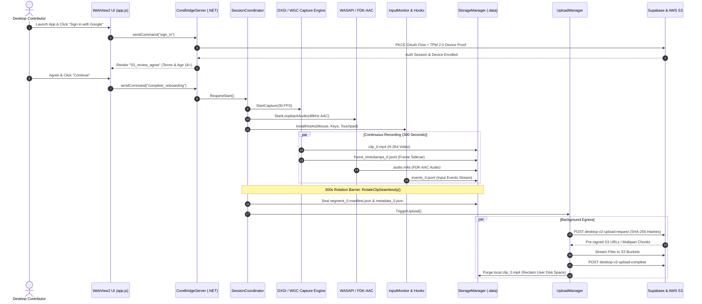

# Kuro Windows Desktop - Comprehensive Technical Architecture & Codebase Blueprint

> **Artifact:** `KuroWindows-win-Setup.exe` (Version `1.1.19.0`, Architecture: `win-x64`)  
> **Internal Project Identity:** `markov-screen-recorder-tool` / `KuroWindows`  
> **Runtime Target:** Microsoft .NET 8.0 Windows Desktop App (`net8.0-windows10.0.19041.0`)  
> **UI Layer:** Microsoft Edge WebView2 (Sandboxed HTML5/ES6, CSP `connect-src 'none'`)  
> **Decompiled Source Root:** [`d:\Kuro and Loggy3\decompiled/`](file:///d:/Kuro%20and%20Loggy3/decompiled)  
> **Technical Docs Root:** Repository Root Documentation

---

## 1. Executive Summary: What is Kuro & How Does It Work?

### 1.1 Plain-Language Explanation
**Kuro** is a high-performance Windows desktop application that captures verified desktop telemetry, screen video, system audio, and user interaction patterns. Desktop contributors run Kuro to earn rewards or telemetry credits based on their verified desktop activity.

The application captures:
1. **Ultra-smooth display video** (30 FPS H.264 video of each active monitor using GPU hardware acceleration).
2. **Crystal-clear system audio** (desktop playback audio captured via WASAPI loopback and compressed with Fraunhofer FDK-AAC).
3. **Millisecond-accurate input telemetry** (cursor trajectories, mouse clicks, keyboard scan codes, and multi-finger touchpad gestures).
4. **Application context** (active window titles, browser URLs, UI accessibility trees).

To protect user confidentiality, Kuro includes an **automated privacy and masking engine** that instantly blinds video frames and drops keystrokes whenever password fields, webcams, lock screens, or sensitive banking/medical portals are detected. It also scans running processes for competing screen recorders or conflicting software (capture contention).

All data is sliced into **300-second (5-minute) immutable segments**, sealed with cryptographic SHA-256 manifests, signed with hardware TPM 2.0 silicon private keys, and uploaded directly to Amazon S3 via Supabase cloud orchestration.

---

## 2. End-to-End Application Lifecycle (The Big Picture)



---

## 3. High-Level System Architecture

Kuro enforces strict process boundaries between native hardware ingestion, out-of-process accessibility probing, and sandboxed presentation:

```mermaid
flowchart TB
    subgraph WindowsOS["Windows Operating System"]
        Win32Hooks["Win32 Low-Level Hooks\n(WH_MOUSE_LL / WH_KEYBOARD_LL)"]
        DDA["DXGI Desktop Duplication API\n/ Windows.Graphics.Capture"]
        WASAPI["WASAPI Loopback Capture\n(IAudioClient / IAudioCaptureClient)"]
        TPM["TPM 2.0 Silicon\n(Microsoft Platform Crypto Provider)"]
        CredMgr["Windows Credential Manager\n/ DPAPI Fallback"]
        UIA_OS["UI Automation COM Tree"]
    end

    subgraph MainHost["KuroWindows.exe (Main Host Process)"]
        App["App.xaml.cs & Program.cs\n(STA Dispatcher Thread + SingleInstanceMutex)"]
        
        subgraph Coordinators["State Coordinators"]
            SessionCoord["SessionCoordinator.cs\n(Idle, Recording, Paused, PrivacyPaused, LowDisk)"]
            ContentionMon["CaptureContentionMonitor.cs\n(5s Process & Authenticode Scanner)"]
            PrivacyMgr["PrivacyManager.cs\n(Password, Webcam, Window Masking)"]
            SyncMgr["DesktopSyncManager.cs\n(Cloud Feature Flags & Masking Policy)"]
            UploadMgr["UploadManager.cs\n(S3 Multipart / Single-Part Pipeline)"]
        end

        subgraph Ingestion["Hardware Ingestion Engines"]
            CaptureEngine["DisplayCapture.cs / Gen2 GPU\n(Vortice D3D11 / TextureVideoEncoder)"]
            AudioEngine["SystemAudioSession.cs\n(SampleRing + FDK-AAC Encoder)"]
            InputEngine["InputMonitor.cs\n(Win32 Message Loop + PtpGestureMachine)"]
            UiaHost["UiaProbeHost.cs\n(Named Pipe Client)"]
        end

        subgraph StorageEgress["Storage & Local Vault"]
            StorageMgr["StorageManager.cs\n(%APPDATA%/Kuro/.data)"]
            TelemetryEngine["ClientTelemetry.dll\n(UUIDv7, Batching, AWS Ingest)"]
        end

        subgraph IPCContainer["IPC & Presentation Container"]
            BridgeServer["CoreBridgeServer.cs\n(Bi-Directional JSON-RPC)"]
            ShellWindow["ShellWindow.xaml.cs\n(WPF Borderless Window Host)"]
            WebViewCtrl["Edge WebView2 Runtime\n(VirtualHost: https://kuro-app.example/)"]
        end
    end

    subgraph UIAWorker["KuroWindows.exe --uia-probe (Worker Process)"]
        ProbeWorker["UiaProbeWorker.cs\n(MTA Apartment + Parent PID Watchdog)"]
    end

    subgraph WebViewSandbox["msedgewebview2.exe (Renderer Process)"]
        FrontendDOM["index.html + styles.css + app.js\n(20 Design States, CSP connect-src 'none')"]
        Communications["communications.js\n(Guard Notice Raycasting Engine)"]
    end

    %% Wiring
    Win32Hooks --> InputEngine
    DDA --> CaptureEngine
    WASAPI --> AudioEngine
    TPM <--> App
    CredMgr <--> App
    UIA_OS <--> ProbeWorker

    UiaHost <-->|Named Pipe: KuroWindowsUiaProbe-*| ProbeWorker
    
    CaptureEngine & AudioEngine & InputEngine --> StorageMgr
    StorageMgr --> UploadMgr
    
    SessionCoord --> CaptureEngine
    SessionCoord --> AudioEngine
    SessionCoord --> InputEngine
    SessionCoord --> StorageMgr
    
    ContentionMon --> SessionCoord
    PrivacyMgr --> SessionCoord
    SyncMgr --> SessionCoord
    
    BridgeServer <--> SessionCoord
    BridgeServer <--> UploadMgr
    BridgeServer <--> SyncMgr
    BridgeServer <--> ShellWindow
    
    ShellWindow --> WebViewCtrl
    WebViewCtrl <-->|window.chrome.webview.postMessage| FrontendDOM
    FrontendDOM --> Communications
```



---

## 4. Complete Codebase File Catalog

Below is the complete inventory of all first-party C# files, UI scripts, native libraries, and configuration files across the Kuro codebase.

### 4.1 Host Application & Coordinators (`csharp_source/KuroWindows/KuroWindows/`)

| File Name | Responsibility | Key Classes & Methods | Internal Logic & Features |
| :--- | :--- | :--- | :--- |
| **`Program.cs`** | Application Entrypoint | `Program.Main()`, `RunRecorder()`, `SeedDesktopConfigFromCache()` | Inspects CLI arguments (`--uia-probe` vs normal). Installs WER local crash dumps and exception handlers; seeds cached cloud config; initializes Velopack; acquires single-instance mutex `Global\KuroWindows_SingleInstance`. If a second instance is launched, forwards commands via Named Pipe and terminates. |
| **`App.xaml.cs`** | WPF Application Lifecycle | `App.OnStartup()`, `HandleAppCommand()`, `ShowShellWindow()`, `QuitAsync()` | Owns WPF UI Dispatcher thread; handles `--auth-callback` protocol URLs; starts background hardware and memory diagnostics; initializes system tray via `DesktopStatus`; warms up TPM 2.0 CNG keys; starts `AppCommandServer`; runs `InterruptedSessionRecovery`; instantiates `SessionCoordinator`, `UploadManager`, `CoreBridgeServer`, and `ShellWindow`. |
| **`AppConfig.cs`** | Master Configuration Catalog | `AppConfig` static class | Central repository of all URLs (Supabase `https://auth.trykuro.app`, AWS Telemetry `https://rj4mawk0tj.execute-api.us-east-1.amazonaws.com/v1/batches`, Velopack updates, Intel/AMD TPM PKI) and system thresholds (30 FPS, 300s clip rotation, 2GB disk floor, 8ms mouse coalescing, 400ms UIA timeout). |
| **`SessionCoordinator.cs`** | Core Recording State Machine | `SessionCoordinator`, `RotateClipSeamlessly()`, `RequestStart()`, `StopSessionAsync()` | Finite State Machine governing `Idle`, `Recording`, `Paused`, `PrivacyPaused`, `LowDisk`, and `UpdateRequired`. Manages the 300-second clip rotation timer; synchronizes multi-display recording; handles display hot-plugging; coordinates with `UploadManager` to seal completed segments. |
| **`SessionState.cs`** | State Enum | `enum SessionState` | Defines the 6 canonical coordinator states: `Idle`, `Recording`, `Paused`, `PrivacyPaused`, `LowDisk`, `UpdateRequired`. |
| **`SessionParks.cs`** | Parked State Manager | `SessionParks`, `ObservePark()`, `RecheckParkedPrivacyContext()` | Manages held states and resume tokens when recording is suspended by privacy masking, display sleep, or user lock screen. |
| **`AppCommandServer.cs`** | Second-Instance IPC | `AppCommandServer`, `HandleAppCommand()` | Named Pipe server (`\\.\pipe\KuroWindowsAppCommand`) allowing a second instance to deliver `show-settings` or `quit` to the primary instance. |
| **`LocalPipes.cs`** | Pipe Security Helper | `LocalPipes.CreateServerPipe()` | Configures Windows Named Pipe security attributes, buffer sizes, and current-user ACLs. |
| **`KuroLog.cs`** | Internal Diagnostic Logger | `KuroLog.App()`, `Capture()`, `Auth()`, `Crash()`, `LocalOnly()` | Categorized diagnostic logger outputting caller member names, file paths, and line numbers to console, disk, and telemetry. |
| **`KuroTelemetry.cs`** | Telemetry Adapter | `KuroTelemetry.Start()`, `SyncIdentity()`, `ApplyConfig()` | Bridges host application events to the standalone `ClientTelemetry.dll` batching engine. |
| **`TelemetryMap.cs`** | Event ID Mapper | `TelemetryMap.ResolveEventId()` | Maps internal state changes into wire event codes for AWS telemetry ingestion. |

---

### 4.2 Authentication & Cloud Security (`csharp_source/KuroWindows/KuroWindows.Auth/`)

| File Name | Responsibility | Key Classes & Methods | Internal Logic & Features |
| :--- | :--- | :--- | :--- |
| **`AuthManager.cs`** | Authentication State Controller | `AuthManager.Instance`, `BeginSignInAsync()`, `CompleteSignInAsync()`, `SignOutAsync()` | Orchestrates OAuth 2.0 PKCE flow. Starts local loopback server or registers protocol scheme; exchanges code with Supabase; generates TPM 2.0 device proof; stores tokens in Windows Credential Manager; handles automatic token refresh with Bearer retry logic. |
| **`APIClient.cs`** | Supabase Edge Functions Client | `APIClient`, `SendAuthedAsync()`, `CompleteSignInAsync()`, `RegisterDeviceAsync()` | High-performance HTTP client talking to Supabase Edge Functions (`desktop-v2-*`). Automatically signs requests with TPM 2.0 device proofs (`kuro-device-proof/v1`) and attaches Bearer JWTs. |
| **`CredentialStore.cs`** | Windows Secure Credential Vault | `CredentialStore.Save()`, `Load()`, `Delete()` | Securely stores session tokens using Windows Credential Manager (`advapi32.dll` `CredWriteW` / `CredReadW`) under target `com.kuro.app.auth`. Features transparent fallback to DPAPI-encrypted file (`session.dpapi` via `crypt32.dll` `CryptProtectData`). |
| **`ConsentRecorder.cs`** | Legal Consent Compliance | `ConsentRecorder.Instance`, `Enqueue()`, `FlushAsync()` | Records user agreement to Terms of Service (`tos`) and Privacy Policy (`privacy_policy`) (version `2026-03-28`) and age 18+ confirmation; syncs signed consent records to Supabase. |
| **`LoopbackOAuthCallbackServer.cs`** | Local HTTP Callback Listener | `LoopbackOAuthCallbackServer`, `Start()`, `Stop()` | Embeds an HTTP listener on `http://127.0.0.1:57391/auth/callback` with a 5-minute timeout window. Renders a clean branded HTML success page upon receiving authorization codes. |
| **`OAuthCallbackServer.cs`** | Custom Protocol Listener | `OAuthCallbackServer.RegisterUrlScheme()`, `ForwardCallbackToRunningInstance()` | Fallback OAuth listener. Registers `com.kuro.app://` in the Windows Registry; intercepts callbacks when loopback is blocked; forwards codes via named pipe `KuroWindowsOAuthCallback`. |
| **`SupabaseTokenResponse.cs`** | Token DTO | `SupabaseTokenResponse` | Models Supabase OAuth JWT response (`access_token`, `refresh_token`, `expires_in`, `user`). |
| **`CompleteSignInResponse.cs`** | Sign-In DTO | `CompleteSignInResponse`, `CompleteSignInProfile` | Models the response from `desktop-v2-complete-signin` containing contributor profile and device status. |

---

### 4.3 Hardware Capture & Video Encoding (`csharp_source/KuroWindows/KuroWindows.Capture/` & `Gen2/`)

| File Name | Responsibility | Key Classes & Methods | Internal Logic & Features |
| :--- | :--- | :--- | :--- |
| **`DisplayCapture.cs`** | DXGI DDA Screen Capture Engine | `DisplayCapture`, `AcquireNextFrame()`, `ProcessFrame()` | Interfaces with DirectX 11 DXGI 1.2 Desktop Duplication API (`IDXGIOutputDuplication`). Extracts raw GPU desktop textures, detects dirty rects, scales frames, renders mouse pointer, and feeds the video encoder. |
| **`DisplayRecorder.cs`** | Display Worker Thread | `DisplayRecorder.RunCaptureLoop()` | Dedicated per-display thread running the continuous frame acquisition and encoding loop. |
| **`WgcMonitorCaptureBackend.cs`** | WinRT Screen Capture Engine | `WgcMonitorCaptureBackend`, `Start()`, `OnFrameArrived()` | Modern capture engine utilizing `Windows.Graphics.Capture` (WGC) for Windows 10/11. Supports capturing windows and monitors without yellow capture borders. |
| **`WgcInterop.cs`** | WinRT Native Interop | `WgcInterop.CreateItemForMonitor()` | Win32 interop activating `IGraphicsCaptureItemInterop` via native COM pointers. |
| **`BgraFrameScaler.cs`** | Frame Scaler | `BgraFrameScaler.Scale()` | High-performance bilinear image scaler resizing non-standard monitor resolutions to standard video encoding targets. |
| **`CursorRenderer.cs`** | Mouse Cursor Compositor | `CursorRenderer.DrawCursor()` | Extracts Win32 cursor shape, hotspot, and visibility via `GetCursorInfo` and `GetIconInfoEx`; composites cursor bitmap onto video frames with sub-pixel accuracy. |
| **`CaptureCadenceController.cs`**| 30 FPS Frame Pacer | `CaptureCadenceController.Evaluate()` | Enforces a strict 30.0 FPS pacing (33.33ms period) using QPC (QueryPerformanceCounter) monotonic ticks. Detects and tags dropped frames in sidecar logs. |
| **`CaptureDeniedHold.cs`** | Secure Desktop Hold | `CaptureDeniedHold.Enter()`, `CheckHold()` | Traps `CaptureAccessDeniedException` (Windows UAC prompts, lock screen, DRM video) and emits black frames to protect administrative credentials. |
| **`VideoEncoder.cs`** | Hardware H.264 Encoder | `VideoEncoder.Initialize()`, `WriteFrame()`, `Finalize()` | Configures Windows Media Foundation hardware transforms (MFT) for H.264 video compression (supporting NVIDIA NVENC, Intel QuickSync, AMD AMF). |
| **`VideoBitratePolicy.cs`** | Dynamic Bitrate Calculator | `VideoBitratePolicy.CalculateBitrate()` | Calculates video encoding bitrate scaled to display resolution (2500 kbps for 1080p, 3800 for 1440p, 7200 for 4K). Throttles bitrate by 25% upon encoder stalls. |
| **`FrameSidecarWriter.cs`** | Frame Metadata Writer | `FrameSidecarWriter.WriteFrameRecord()` | Writes JSONL records for every single video frame (`SidecarSchema = 2`), recording PTS, duration, dropped frames, cursor coordinates, and active window. |
| **`SegmentWriter.cs`** | Single-Display Segment Coordinator | `SegmentWriter.WriteFrame()`, `Dispose()` | Coordinates video encoding and frame sidecar writing for a single monitor during a 300-second recording window. |
| **`SegmentSet.cs`** | Multi-Display Synchronizer | `SegmentSet.Rotate()`, `Seal()` | Manages multi-monitor segment arrays, ensuring all displays rotate atomically at the 300-second boundary. |
| **`SegmentEventFiles.cs`** | Input Stream Multiplexer | `SegmentEventFiles.AppendAll()`, `Append()` | Multiplexes input events across per-display JSONL streams with UTF-8 BOM headers. |
| **`Gen2/GpuV2CaptureBackend.cs`**| Pure GPU Capture Backend | `GpuV2CaptureBackend`, `AcquireNextFrame()` | Next-gen Direct3D 11 pure VRAM pipeline. Eliminates CPU memory copies by keeping textures entirely in GPU memory. |
| **`Gen2/TextureVideoEncoder.cs`**| Direct3D Texture Video Encoder | `TextureVideoEncoder.EncodeTexture()` | Directly feeds Direct3D 11 textures into hardware video encoders using Direct3D texture share handles. |
| **`Gen2/Gen2Shaders.cs`** | Direct3D Pixel Shaders | `Gen2Shaders.CompileShaders()` | GPU pixel shaders executing high-speed hardware color space conversion (BGRA to NV12) directly on the graphics card. |

---

### 4.4 Input Monitoring & Precision Touchpad (`csharp_source/KuroWindows/KuroWindows.Input/` & `Touchpad/`)

| File Name | Responsibility | Key Classes & Methods | Internal Logic & Features |
| :--- | :--- | :--- | :--- |
| **`InputMonitor.cs`** | Low-Level Input Hook Engine | `InputMonitor`, `MouseHookProc()`, `KeyboardHookProc()`, `Start()` | 100KB Win32 input ingestion engine. Installs `WH_MOUSE_LL` and `WH_KEYBOARD_LL` hooks, tracks window focus changes via `SetWinEventHook`, clipboard updates via `AddClipboardFormatListener`, and translates scan codes to Unicode using `ToUnicodeEx`. Coalesces mouse motion every 8ms. |
| **`RowSerializer.cs`** | Input Event Serializer | `RowSerializer.Serialize()` | Serializes raw input events into 45-field JSONL records (`timestamp`, `displayIndex`, `channel`, `x`, `y`, `button`, `pressure`, `keyCode`, `characters`, `targetExe`, `hwnd`, etc.). |
| **`PrivacyManager.cs`** | Real-Time Privacy Masker | `PrivacyManager.Prime()`, `MatchSensitiveContextLocked()` | Real-time privacy evaluator. Masks or pauses capture when `LockApp.exe` is active, password fields are focused, webcams are running, or active window titles match cloud regex filters. |
| **`CapabilityUsageMonitor.cs`** | Hardware Capability Monitor | `CapabilityUsageMonitor.PollCapabilities()` | Monitors Windows registry keys (`CapabilityAccessManager\ConsentStore\webcam`) to detect active webcam or microphone usage. |
| **`CaptureContentionMonitor.cs`**| Process Contention Scanner | `CaptureContentionMonitor.ScanProcesses()` | 5-second background audit. Enumerates running processes, extracts Authenticode certificate signers, internal names, and file descriptions, hashes them with SHA-256, and raises alerts if competing screen recorders are detected. |
| **`BrowserCatalog.cs`** | Browser Tab Inspector | `BrowserCatalog.GetActiveTabInfo()` | Evaluates active browser executables (Chrome, Edge, Firefox, Brave, Opera) and extracts active window titles and URLs. |
| **`Touchpad/HidInterop.cs`** | Raw HID Interop | `HidInterop.GetPreparsedData()`, `GetCaps()` | Win32 interop for `hid.dll` communicating with raw HID digitizers and touchpads. |
| **`Touchpad/PtpDevicePlan.cs`** | HID Descriptor Parser | `PtpDevicePlan.CreatePlan()` | Parses HID report descriptors for Digitizer usage page (`0x0D`) and Touch Pad usage (`0x05`), extracting contact IDs, tip switch status, confidence bits, and sub-millimeter coordinates. |
| **`Touchpad/PtpFrameAssembler.cs`**| Touchpad Contact Assembler | `PtpFrameAssembler.FeedReport()` | Collects simultaneous multi-finger contacts from fragmented HID packets into atomic time-synchronized `PtpFrame` records. |
| **`Touchpad/PtpGestureMachine.cs`**| Multi-Touch Gesture Recognizer | `PtpGestureMachine.ProcessFrame()` | Gesture recognition state machine detecting two-finger scroll velocity, inertia momentum phases, pinch-to-zoom distance changes, and multi-finger taps. |
| **`Touchpad/TouchpadChannel.cs`**| Touchpad Telemetry Channel | `TouchpadChannel.Start()` | Integrates the PTP gesture machine with the input monitor, emitting structured touchpad events to `events_*.jsonl`. |

---

### 4.5 UI Automation Worker Process (`csharp_source/KuroWindows/KuroWindows.Input.Uia/`)

| File Name | Responsibility | Key Classes & Methods | Internal Logic & Features |
| :--- | :--- | :--- | :--- |
| **`UiaProbeWorker.cs`** | Standalone UIA Subprocess | `UiaProbeWorker.Run()`, `Serve()`, `StartParentReaper()` | Out-of-process worker launched with `KuroWindows.exe --uia-probe <PipeName> <ParentPid>`. Runs in an isolated MTA apartment with disabled crash dialogs (`SetErrorMode`). Includes a watchdog thread terminating the process immediately if the parent dies. |
| **`UiaProbeHost.cs`** | Main Host UIA Client | `UiaProbeHost.ProbeElementAsync()`, `EnsureWorker()` | Communicates with `UiaProbeWorker` over Named Pipes. Enforces strict query deadlines (`UiaProbeBridgeDeadlineMs = 400ms`) to prevent external application UI freezes from stalling Kuro. |
| **`UiaGuard.cs`** | Password Element Detector | `UiaGuard.IsSecureFieldFocused()` | Queries UI Automation tree to evaluate `IUIAutomationElement.CurrentIsPassword` on active controls. |
| **`UiaProbeProtocol.cs`** | Binary IPC Protocol | `UiaProbeProtocol.WriteRequest()`, `ReadResponse()` | Binary serialization protocol for fast request/response dispatch across Named Pipes. |

---

### 4.6 System Audio Ingestion (`csharp_source/SystemAudio/SystemAudio/`)

| File Name | Responsibility | Key Classes & Methods | Internal Logic & Features |
| :--- | :--- | :--- | :--- |
| **`SystemAudioSession.cs`** | Audio Subsystem Controller | `SystemAudioSession.Start()`, `Stop()`, `CaptureLoop()` | Coordinates WASAPI loopback capture, lock-free sample ring buffering, and native AAC audio compression. |
| **`AudioClient.cs`** | WASAPI Loopback Client | `AudioClient.InitializeLoopback()` | Interfaces with Windows CoreAudio (`IMMDeviceEnumerator.GetDefaultAudioEndpoint`) using `AUDCLNT_STREAMFLAGS_LOOPBACK` and event-driven buffers. |
| **`SampleRing.cs`** | Lock-Free Audio Buffer | `SampleRing.Write()`, `Read()` | High-concurrency circular sample ring buffer decoupling the real-time WASAPI callback thread from the audio compression pipeline. |
| **`FdkAacInterop.cs`** | Native FDK-AAC Interop | `FdkAacInterop.aacEncOpen()`, `aacEncEncode()` | Native C P/Invoke bindings interfacing directly with `fdk-aac.dll`. |
| **`AacEncoder.cs`** | AAC Compression Engine | `AacEncoder.Encode()`, `Configure()` | Configures 48 kHz stereo AAC-LC 128 kbps compression using the Fraunhofer library. |
| **`AudioSegmentWriter.cs`** | Audio File Writer | `AudioSegmentWriter.WriteAudioPacket()` | Formats and writes compressed AAC frames into synchronized `audio.m4a` / `audio.mp4` segment files. |

---

### 4.7 Storage, Manifests & Cloud Egress (`csharp_source/KuroWindows.Storage/`, `Segments/`, `Upload/`)

| File Name | Responsibility | Key Classes & Methods | Internal Logic & Features |
| :--- | :--- | :--- | :--- |
| **`StorageManager.cs`** | Disk Storage Manager | `StorageManager.RecordingsDirectory()`, `AvailableDiskSpaceBytes()` | Manages local recording directories in `%APPDATA%\Kuro\.data\` (marked hidden). Enforces disk space safety thresholds using Win32 `GetDiskFreeSpaceExW`. |
| **`InterruptedSessionRecovery.cs`**| Crash Salvage Engine | `InterruptedSessionRecovery.Recover()` | Cold boot scanner. Detects unsealed sessions containing `.active-session.json`; calculates SHA-256 digests; generates synthetic manifests tagged `recovered_from_crash` to salvage partial recordings. |
| **`SegmentManifest.cs`** | Sealed Segment Manifest | `SegmentManifest`, `SegmentDisplayManifest` | Data structure representing `segment_<index>.manifest.json` holding display metadata, frame counts, byte sizes, and SHA-256 hashes. |
| **`SegmentManifestStore.cs`** | Manifest Persistence | `SegmentManifestStore.Save()`, `Load()` | Reads, writes, and cryptographically validates sealed segment manifests on disk. |
| **`MetadataBuilder.cs`** | Forensics Metadata Builder | `MetadataBuilder.Build()` | Aggregates rich metadata for `metadata_<index>.json` (CPU/GPU specs, SMBIOS serials, display topology, keystroke/click counters, masking triggers, timing validation). |
| **`UploadManager.cs`** | Asynchronous Upload Coordinator| `UploadManager.RunUploadCycleAsync()`, `UploadSegmentAsync()` | 100KB background service. Sweeps sealed segments, requests pre-signed URLs from Supabase (`desktop-v2-upload-request`), executes single-part or multipart S3 uploads, and purges local media files. |
| **`S3Uploader.cs`** | S3 HTTP Client | `S3Uploader.UploadFileAsync()`, `UploadPartAsync()` | Executes HTTP `PUT` requests to Amazon S3 with progress tracking (`ProgressStreamContent`) and chunked multipart assembly (`RangedProgressStreamContent`). |
| **`UploadFailurePolicy.cs`** | Upload Retry Scheduler | `UploadFailurePolicy.ScheduleRetry()` | Implements progressive retry delays (`[60s, 180s, 300s]`) for transient failures and quarantines files failing SHA-256 checks. |

---

### 4.8 CoreBridge IPC & Presentation (`csharp_source/KuroWindows.CoreBridge/`, `UI/`, `decompiled/ui/`)

| File Name | Responsibility | Key Classes & Methods | Internal Logic & Features |
| :--- | :--- | :--- | :--- |
| **`CoreBridgeServer.cs`** | Bi-Directional IPC Hub | `CoreBridgeServer.ExecuteAsync()`, `BroadcastSnapshot()` | JSON-RPC 2.0-style server communicating over WebView2 message ports. Handles commands (`start_recording`, `stop_recording`, `sign_in`, `get_dashboard`, `request_payout`, etc.) and broadcasts `CoreBridgeSnapshot`. |
| **`CoreBridgeSnapshot.cs`** | System Snapshot DTO | `CoreBridgeSnapshot` | Unified JSON state model holding application version, auth state, device ID, sync status, recording status, upload queue metrics, and disk space. |
| **`ShellWindow.xaml.cs`** | WPF Window Container | `ShellWindow`, `OnWebMessageReceived()`, `ShowAndFocus()` | Borderless WPF window hosting Edge WebView2. Handles window dragging (`WM_NCLBUTTONDOWN`), resizing (`solo` 600x400 vs `dashboard` 800x600), minimizing, and virtual host domain mapping (`https://kuro-app.example/`). |
| **`ui/index.html`** | Webview Entrypoint HTML | Document Structure & CSP Meta Tag | Sandboxed HTML5 skeleton with strict Content Security Policy (`connect-src 'none'`). |
| **`ui/app.js`** | Frontend MVC & State Machine | `render()`, `sendCommand()`, `handleHostMessage()` | 3,093 lines of vanilla JavaScript. Manages 20 design states (`01_welcome` through `14_capture_contention`), UI rendering loops, tab navigation (`account`, `earnings`, `referrals`, `permissions`), and payout modals. |
| **`ui/communications.js`** | Legal Notice Presentation | `createPresentation()`, `fullyVisible()`, `present()` | Verifiable guard notice engine. Casts 5 test rays via `elementFromPoint` and measures text client rects to verify physical user visibility before dispatching legal delivery receipts. |
| **`ui/styles.css`** | UI Stylesheet | CSS Grid & Flexbox Layouts | Layout rules for borderless window chrome, sidebar navigation, buttons, toggles, tables, and dialog overlays. |
| **`ui/colors_and_type.css`** | Theming Variables | CSS Custom Properties | Defines `--ts-surface`, `--ts-ink`, `--status-good`, `--status-warn`, `--status-bad`, and font family stacks for Light and Dark modes. |

---

### 4.9 Device Identity & Cryptographic Hardware Attestation (`csharp_source/DeviceIdentity/DeviceIdentity/`)

| File Name | Responsibility | Key Classes & Methods | Internal Logic & Features |
| :--- | :--- | :--- | :--- |
| **`DeviceKey.cs`** | TPM 2.0 Hardware Key Manager | `DeviceKey.GetOrCreateHardwareKey()`, `SignData()` | Connects to physical TPM 2.0 silicon via Windows CNG (`ncrypt.dll`, `"Microsoft Platform Crypto Provider"`). Generates non-exportable ECDSA P-256 (or RSA 2048) keys. |
| **`DeviceProof.cs`** | Attestation Signature Generator | `DeviceProof.CreateProofHeaders()` | Computes canonical request signature strings (`kuro-device-proof/v1`) using the TPM hardware private key. |
| **`TpmEndorsement.cs`** | TPM EK Certificate Extractor | `TpmEndorsement.GetEndorsementCertificate()` | Extracts TPM Endorsement Certificates (EK) from NVRAM (`0x01c00002`) or retrieves them from Intel EKOP / AMD fTPM PKI services. |
| **`HardwareFacets.cs`** | Hardware & Anti-VM Auditor | `HardwareFacets.CollectFacets()`, `CheckHypervisor()` | Queries WMI for motherboard UUID and SMBIOS serials; audits CPUID hypervisor bit and vendor strings; runs 200ms cloud metadata probe to detect VM environments. |
| **`RemoteControlProbe.cs`** | Remote Desktop Detector | `RemoteControlProbe.IsRemoteSessionActive()` | Checks `GetSystemMetrics(SM_REMOTESESSION)` and Terminal Services APIs to detect RDP, TeamViewer, AnyDesk, and VNC sessions. |
| **`Wmi.cs`** | WMI Query Helper | `Wmi.QueryProperty()` | Safe Win32 WMI reader querying `Win32_BaseBoard` and `Win32_ComputerSystemProduct`. |

---

### 4.10 Updates & Remote Policy Synchronization (`csharp_source/DesktopUpdates/`, `KuroWindows.Sync/`)

| File Name | Responsibility | Key Classes & Methods | Internal Logic & Features |
| :--- | :--- | :--- | :--- |
| **`UpdateService.cs`** | Velopack Auto-Updater Service | `UpdateService.CheckNow()`, `InstallNow()` | Background service polling Velopack feed `https://updates.trykuro.app/win`. Stages delta packages (`.nupkg`) and applies them on restart. |
| **`VersionFloor.cs`** | Mandatory Version Enforcer | `VersionFloor.CheckVersionAsync()` | Queries `desktop-v2-check-version`. If client version is below mandatory floor, blocks recording and forces update installation. |
| **`DesktopSyncManager.cs`** | Cloud Configuration Synchronizer | `DesktopSyncManager.SyncAsync()` | Periodically fetches updated feature flags, video bitrates, and masking lists from Supabase (`desktop-v2-sync`) and caches them in `desktop_config.json`. |
| **`DesktopConfigCache.cs`** | Local Config Cache | `DesktopConfigCache.Save()`, `Load()` | Manages offline caching of cloud configuration in `%APPDATA%\Kuro\desktop_config.json`. |

---

### 4.11 Client Telemetry & Health Monitoring (`csharp_source/ClientTelemetry/`, `KuroWindows.Diagnostics/`)

| File Name | Responsibility | Key Classes & Methods | Internal Logic & Features |
| :--- | :--- | :--- | :--- |
| **`Telemetry.cs`** | Telemetry Ingestion Hub | `Telemetry.Enqueue()`, `Drain()` | In-memory batching queue for operational metrics, frame drop counts, and error events. |
| **`Writer.cs`** | On-Disk Ring Buffer Spooler | `Writer.WriteBatch()`, `Flush()` | High-reliability disk spooler ensuring telemetry events are preserved across offline periods and crashes. |
| **`UuidV7.cs`** | Monotonic UUIDv7 Generator | `UuidV7.NewGuid()` | Generates RFC 4122 UUIDv7 identifiers combining 48-bit millisecond timestamps, 12-bit sequence counters, and 62 bits of entropy. |
| **`CrashDiagnostics.cs`** | WER & Exception Trapper | `CrashDiagnostics.InstallProcessHandlers()`, `ConfigureWerLocalDumps()` | Configures Windows Error Reporting registry keys to write local mini-dumps to `%LOCALAPPDATA%\CrashDumps` on unhandled crashes. |
| **`PostCrashReporter.cs`** | Post-Mortem Crash Reporter | `PostCrashReporter.ReportPreviousCrashIfAny()` | Scans `%LOCALAPPDATA%\CrashDumps` on startup, parses mini-dump headers via `DbgHelp.dll`, and transmits crash stack traces to AWS telemetry. |
| **`WebView2Health.cs`** | Edge Runtime Health Monitor | `WebView2Health.CheckAndAutoRepairInBackgroundAsync()` | Probes WebView2 installation health; handles renderer crashes (`ProcessFailed`); reloads browser up to 3 times or triggers repair. |

---

## 5. Subsystem Deep-Dives

### 5.1 Capture Pipeline & Video Pacing
Kuro captures each physical display independently at **30.0 FPS** using Direct3D 11:
- **Frame Acquisition:** `IDXGIOutputDuplication.AcquireNextFrame` locks the desktop surface.
- **Dirty Rect Processing:** If unchanged, duplicate frame counts are incremented without re-encoding to save bandwidth.
- **Color Space Conversion:** Direct3D 11 pixel shaders (`Gen2Shaders.cs`) convert BGRA surfaces to NV12 directly in GPU VRAM.
- **Bitrate Adaptation:** Video bitrates scale dynamically based on resolution ($2,500\text{ kbps}$ for 1080p, $3,800\text{ kbps}$ for 1440p, $7,200\text{ kbps}$ for 4K). Encoder queue stalls automatically throttle bitrates by 25%.

### 5.2 System Audio Loopback & Compression
- **WASAPI Capture:** Initializes the default audio endpoint with `AUDCLNT_STREAMFLAGS_LOOPBACK` in event-driven mode.
- **Lock-Free Buffering:** Audio frames stream into `SampleRing.cs`, decoupling real-time audio threads from compression.
- **Fraunhofer FDK-AAC:** Native `fdk-aac.dll` encodes 48 kHz stereo PCM into High-Efficiency / Low-Complexity AAC (AAC-LC) at 128 kbps.

### 5.3 Precision Touchpad HID Engine
Rather than relying on emulated mouse events, Kuro queries raw HID digitizers:
- **Descriptor Decoding (`PtpDevicePlan.cs`):** Extracts usage page `0x0D` (Digitizer) and usage `0x05` (Touch Pad).
- **Contact Tracking:** Tracks individual finger contact IDs, coordinates, tip switch, and scan times.
- **Gesture State Machine:** Identifies two-finger scrolling, sub-millimeter inertia momentum, pinch-to-zoom distance delta ($\Delta D = \sqrt{\Delta x^2 + \Delta y^2}$), and multi-finger tap gestures.

### 5.4 Privacy, Masking & Contention Scanner
- **Password Masking:** Queries UI Automation COM interfaces; blinds recording whenever `CurrentIsPassword == true`.
- **Webcam Monitoring:** Interrogates Windows registry keys to detect active camera hardware use.
- **Contention Scanner:** Evaluates running processes every 5 seconds, hashing binary names, product descriptions, internal names, and Authenticode certificate signers (`X509Certificate`) to detect competing recording tools.

### 5.5 Hardware TPM 2.0 Attestation
- **Silicon Key Generation:** Creates non-exportable ECDSA P-256 keys inside the physical TPM chip via Windows CNG.
- **Proof Signing:** Signs canonical request strings (`kuro-device-proof/v1`) using hardware private keys.
- **Anti-VM Heuristics:** Audits CPUID hypervisor bits, vendor strings (`VMwareVMware`, `VBoxVBoxVBox`, `Microsoft Hv`, `KVMKVMKVM`), and executes 200ms cloud link-local probes (`169.254.169.254`).

### 5.6 Storage & 300-Second Segment Rotation
- **Directory Layout:** Segments reside in hidden directory `%APPDATA%\Kuro\.data\yyyy-MM-dd_HH-mm-ss\`.
- **Atomic Rotation:** Every 300 seconds, active segment writers detach and fresh writers take over without dropping a single frame.
- **Cryptographic Sealing:** Computes SHA-256 hashes of video, audio, events, and sidecars, writing `segment_<index>.manifest.json` and `metadata_<index>.json`.
- **S3 Egress:** Uploads files to Amazon S3 via single-part HTTP `PUT` (`< 100 MB`) or 10 MB chunked S3 Multipart Uploads (`≥ 100 MB`).

---

## 6. How to Build, Run & Debug the Application

### 6.1 Building from Source
```powershell
# Build entire solution in Release configuration
dotnet build KuroWindows.sln -c Release -r win-x64

# Publish self-contained executable package
dotnet publish KuroWindows\KuroWindows.csproj -c Release -r win-x64 --self-contained -o bin\publish
```

### 6.2 Running with Diagnostic Flags
```powershell
# Enable verbose GPU and Direct3D texture logging
$env:KURO_CAPTURE_DEBUG = "1"

# Launch Kuro in interactive mode
.\bin\publish\KuroWindows.exe
```

### 6.3 Interacting with CoreBridge from DevTools
Uncomment DevTools in `ui/app.js`, press `F12` inside the window, and execute:
```javascript
// Query current system state snapshot
await sendCommand('get_snapshot');

// Manually start or stop recording
await sendCommand('start_recording');
await sendCommand('stop_recording');

// Trigger immediate upload sweep
await sendCommand('retry_uploads');
```

---

## 7. Verification, Security & Integrity Confirmation

- **Security & Privacy Audit:** See [`SECURITY_AND_PRIVACY_AUDIT.md`](SECURITY_AND_PRIVACY_AUDIT.md) for the complete static analysis on personal file access, credential masking limitations, unencrypted staging, and safety guidelines.
- **Bug & Defect Analysis:** See [`BUGS.md`](BUGS.md) for the complete technical catalog of 10 confirmed software bugs, race conditions, memory/handle leaks, and failure scenarios.
- **Decompiled Source Verification:** The decompiled source code in [`decompiled/`](file:///d:/Kuro%20and%20Loggy3/decompiled) has been verified against the original `KuroWindows-win-Setup.exe` binary:
- **Archive Extraction:** All 513 container entries extracted with 0 missing files.
- **Decompilation Success:** 6 out of 6 C# projects decompiled with 0 errors across 1,218 types and 10,480+ methods.
- **Hash Integrity:** All core assemblies (`KuroWindows.dll`, `ClientTelemetry.dll`, `DeviceIdentity.dll`, `SystemAudio.dll`, `DesktopUpdates.dll`, `DesktopStatus.dll`, `fdk-aac.dll`) match their original SHA-256 digests.

