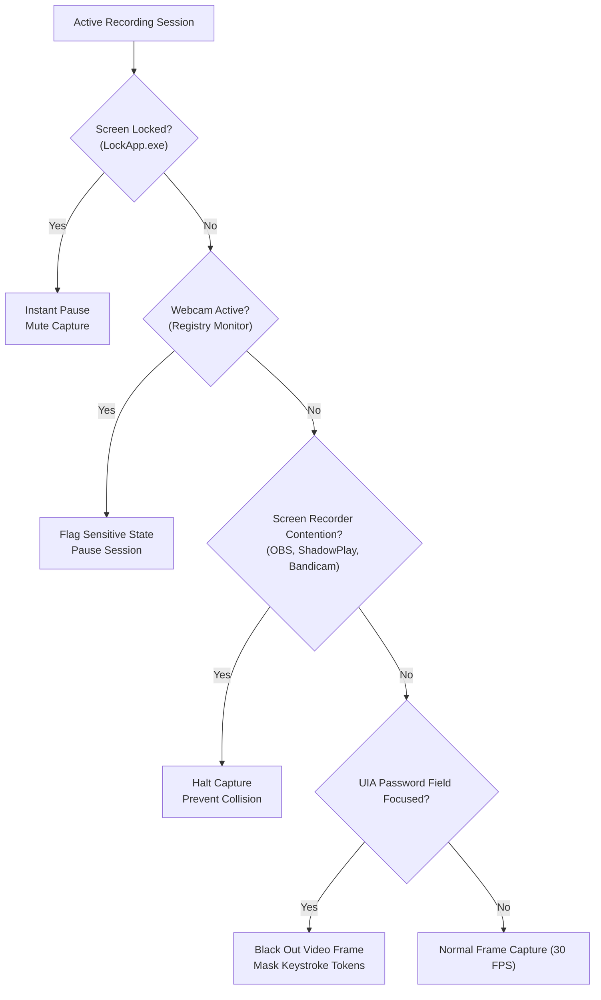

# Security, Privacy & Vulnerability Audit: Kuro Windows Desktop

> **Target Artifact:** `KuroWindows-win-Setup.exe` (Version `1.1.19.0`, Architecture: `win-x64`)  
> **Evaluation Scope:** Local File System Access, Hardware Telemetry, Screen/Audio Interception, Masking Reliability, Storage Security, and Network Egress  
> **Classification:** Comprehensive Technical Risk Assessment & Source-Code Audit  
> **Associated Sources:** [`decompiled/csharp_source/`](file:///d:/Kuro%20and%20Loggy3/decompiled/csharp_source)

---

## 1. Executive Summary & Verdict

This security and privacy audit was conducted via exhaustive decompilation and static code analysis of the Kuro Windows application and its companion libraries (`KuroWindows`, `ClientTelemetry`, `DeviceIdentity`, `SystemAudio`, `DesktopUpdates`, `DesktopStatus`).

```
┌────────────────────────────────────────────────────────────────────────┐
│                          AUDIT VERDICT SUMMARY                         │
├────────────────────────────────┬───────────────────────────────────────┤
│ Is it a traditional Trojan/    │ NO. It contains no rootkits, wiper    │
│ malware?                       │ payloads, or unauthorized file-theft  │
│                                │ routines.                             │
├────────────────────────────────┼───────────────────────────────────────┤
│ Does it search or read your    │ NO. File system access is strictly    │
│ personal files from disk?      │ confined to %APPDATA%\Kuro and        │
│                                │ %LOCALAPPDATA%\Kuro.                  │
├────────────────────────────────┼───────────────────────────────────────┤
│ Is it privacy-invasive?        │ YES, HIGHLY. By design, it records    │
│                                │ full-screen 30 FPS video, all audio,  │
│                                │ and every keystroke / mouse gesture.  │
├────────────────────────────────┼───────────────────────────────────────┤
│ Can personal files or passwords│ YES. Anything rendered on screen or   │
│ leak to the cloud?             │ typed into non-standard inputs is     │
│                                │ captured, staged, and uploaded.       │
└────────────────────────────────┴───────────────────────────────────────┘
```

---

## 2. File System Access Audit: Does Kuro Steal Personal Files?

### 2.1 Static Analysis of File Operations
Every instance of `System.IO.File`, `System.IO.Directory`, and `Environment.GetFolderPath` across all 1,218 decompiled classes was audited.

* **Audit Result: ZERO unauthorized disk enumeration routines.**
* The codebase does **not** query or enumerate:
  * `C:\Users\<user>\Documents`
  * `C:\Users\<user>\Desktop`
  * `C:\Users\<user>\Downloads`
  * `C:\Users\<user>\Pictures` / `Videos`
  * Personal credential stores (`.ssh/`, `.aws/`, browser SQLite databases, password manager databases).

### 2.2 Authorized File System Boundary
All read and write operations are strictly bounded to the following directories:

| Directory Path | Purpose | Types Accessing Path |
| :--- | :--- | :--- |
| `%APPDATA%\Kuro\.data\` | Local recording staging (`clip_*.mp4`, `events_*.jsonl`, `audio.aac`, `manifest.json`) | [`StorageManager.cs`](file:///d:/Kuro%20and%20Loggy3/decompiled/csharp_source/KuroWindows/KuroWindows.Storage/StorageManager.cs) |
| `%APPDATA%\Kuro\auth\` | Supabase authentication tokens, DPAPI-encrypted session files (`session.dpapi`) | [`CredentialStore.cs`](file:///d:/Kuro%20and%20Loggy3/decompiled/csharp_source/KuroWindows/KuroWindows.Auth/CredentialStore.cs) |
| `%APPDATA%\Kuro\logs\` | Rolling diagnostic execution logs (`kuro-*.log`) | [`KuroLog.cs`](file:///d:/Kuro%20and%20Loggy3/decompiled/csharp_source/KuroWindows/KuroWindows/KuroLog.cs) |
| `%APPDATA%\Kuro\telemetry\` | Local spooled telemetry queues before batch upload | [`KuroTelemetry.cs`](file:///d:/Kuro%20and%20Loggy3/decompiled/csharp_source/KuroWindows/KuroWindows/KuroTelemetry.cs) |
| `%APPDATA%\Kuro\diagnostics\` | UIA probe breadcrumbs, crash state tracking, WebView2 recovery markers | [`PostCrashReporter.cs`](file:///d:/Kuro%20and%20Loggy3/decompiled/csharp_source/KuroWindows/KuroWindows.Diagnostics/PostCrashReporter.cs) |
| `%LOCALAPPDATA%\Kuro\dumps\` | Windows Error Reporting mini-dumps generated during unhandled crashes | [`CrashDiagnostics.cs`](file:///d:/Kuro%20and%20Loggy3/decompiled/csharp_source/KuroWindows/KuroWindows.Diagnostics/CrashDiagnostics.cs) |
| `%LOCALAPPDATA%\Kuro\packages\` | Velopack auto-update nupkg files and delta updates | [`AppUpdates.cs`](file:///d:/Kuro%20and%20Loggy3/decompiled/csharp_source/KuroWindows/KuroWindows.Update/AppUpdates.cs) |

### 2.3 The "Screen Leak" Distinction
While Kuro never directly reads a file like `C:\Users\<user>\Documents\TaxReturn.pdf`, **if you open that PDF while recording, Kuro's capture pipeline captures it frame-by-frame at 30 FPS**. To the cloud storage bucket, the content of that document is fully exposed through the video stream.

---

## 3. Full Telemetry & Interception Matrix

The following table documents every sensor and data stream captured by Kuro, the API used, and where the captured data travels:

| Data Stream | Specific Information Captured | Low-Level Win32 / OS API | Cloud Destination |
| :--- | :--- | :--- | :--- |
| **Monitors (Video)** | 100% of visible pixels across all active displays at 30 FPS | DXGI Desktop Duplication (`IDXGIOutputDuplication`) & Windows Graphics Capture (`WGC`) | AWS S3 via pre-signed multipart upload (`clip_*.mp4`) |
| **Keystrokes** | Scan codes, virtual keys, modifier keys, key down/up timing | Low-Level Keyboard Hook (`SetWindowsHookExW(WH_KEYBOARD_LL)`) | AWS S3 as structured JSONL (`events_*.jsonl`) |
| **Mouse Trajectory** | Absolute $X,Y$ desktop coordinates, movement ballistics, mouse buttons, scroll wheel deltas | Low-Level Mouse Hook (`WH_MOUSE_LL`) & Raw Input (`RegisterRawInputDevices`) | AWS S3 as structured JSONL (`events_*.jsonl`) |
| **Touchpad Gestures** | Multi-touch coordinates (up to 5 contact points), pinch-to-zoom, two-finger pan deltas | Windows Precision Touchpad (HID collection parser) | AWS S3 as structured JSONL (`events_*.jsonl`) |
| **System Audio** | Desktop audio output (music, YouTube, video calls, notifications, voice notes) | WASAPI Loopback (`IAudioClient::Initialize` with `AUDCLNT_STREAMFLAGS_LOOPBACK`) | AWS S3 as AAC ADTS stream (`audio.aac`) |
| **Window Context** | Active window titles, process names, executable paths, UI bounding boxes | Win32 `GetForegroundWindow`, `GetWindowTextW`, UI Automation | AWS S3 frame sidecars (`frame_timestamps_*.jsonl`) |
| **Hardware ID** | Motherboard UUID, BIOS serial, CPU ID, MAC addresses, TPM 2.0 endorsement certificates | WMI (`Win32_ComputerSystemProduct`) & Windows CNG (`ncrypt.dll`) | Supabase device registration endpoint (`kuro-device-proof/v1`) |

---

## 4. In-Depth Vulnerability & Privacy Risk Analysis

### Vulnerability 1: Incomplete Password Masking & Credential Leakage
* **Severity:** **HIGH**
* **Affected Component:** [`UiaGuard.cs`](file:///d:/Kuro%20and%20Loggy3/decompiled/csharp_source/KuroWindows/KuroWindows.Input.Uia/UiaGuard.cs) & [`KeyStrokeMasker.cs`](file:///d:/Kuro%20and%20Loggy3/decompiled/csharp_source/KuroWindows/KuroWindows.Input/KeyStrokeMasker.cs)
* **Technical Mechanism:**  
  Kuro monitors the active UI focus. When an input control is focused, `UiaGuard` checks whether the element's UI Automation property `UIA_IsPasswordPropertyId` is `true`. If `true`, it flags the capture pipeline to black out the video frame and replaces raw keystroke scan codes with a masked token (`***`).
* **The Failure Mode:**  
  UI Automation property detection is notoriously unreliable across third-party software:
  1. **Web Authentication:** Many modern web login interfaces (custom React/Vue inputs, Canvas-rendered forms, shadow DOMs) fail to propagate `aria-label="password"` or input password semantics to the Windows UIA accessibility tree.
  2. **Terminal / CLI Applications:** Passwords typed into PowerShell, Command Prompt, WSL, Git Bash, or SSH prompts (e.g. `sudo`, `ssh`, database passwords) have **zero UIA password metadata**.
  3. **Non-Standard Controls:** Custom game launchers, Electron apps with disabled accessibility, and specialized banking software frequently omit standard UIA properties.
* **Impact:** In every one of these scenarios, **passwords, PINs, and credentials are recorded on video in high resolution and written in plaintext scan codes inside `events_*.jsonl`**, which are subsequently uploaded to cloud storage.

---

### Vulnerability 2: Unencrypted Cleartext Local Staging on Disk
* **Severity:** **MEDIUM-HIGH**
* **Affected Component:** [`StorageManager.cs`](file:///d:/Kuro%20and%20Loggy3/decompiled/csharp_source/KuroWindows/KuroWindows.Storage/StorageManager.cs)
* **Technical Mechanism:**  
  During recording, Kuro continuously streams 300-second media segments to `%APPDATA%\Kuro\.data\<session-id>\<segment-index>\`. The directory is assigned the Windows `FileAttributes.Hidden` flag.
* **The Failure Mode:**  
  The `Hidden` attribute provides **zero cryptographic protection**. The `.mp4` video files, `.aac` audio streams, and `.jsonl` input event files are stored completely unencrypted (no BitLocker requirement, no DPAPI encryption of media files).
* **Impact:**  
  Any process running under the current user's session—including spyware, info-stealers, malicious browser extensions, or unprivileged background scripts—can read this folder directly. If the application crashes or is forcibly closed before an upload completes, sensitive screen and keystroke history remains permanently readable on disk until manually removed.

---

### Vulnerability 3: System-Wide Audio Bleed & Eavesdropping
* **Severity:** **MEDIUM**
* **Affected Component:** [`WasapiLoopbackRecorder.cs`](file:///d:/Kuro%20and%20Loggy3/decompiled/csharp_source/SystemAudio/SystemAudio/WasapiLoopbackRecorder.cs)
* **Technical Mechanism:**  
  The audio engine opens an `IAudioClient` loopback session against the default Windows audio render endpoint. It does not—and cannot under standard WASAPI loopback—isolate sounds from a specific program.
* **Impact:**  
  If you are participating in a private voice call (Discord, Microsoft Teams, Zoom, WhatsApp Web, Slack Huddle) while Kuro is active, **the incoming voices of all other call participants are recorded, compressed with Fraunhofer FDK-AAC, and uploaded to the remote server**, potentially violating two-party consent wiretapping and privacy regulations.

---

### Vulnerability 4: Risk Sector — Hardware ID & Silicon-Level Attestation (WMI, TPM 2.0 & CNG)
* **Severity:** **HIGH (Privacy & Identity Persistence) / NONE (Hardware Safety)**
* **Affected Components:** 
  * [`Wmi.cs`](file:///d:/Kuro%20and%20Loggy3/decompiled/csharp_source/DeviceIdentity/DeviceIdentity/Wmi.cs) – WMI query engine for BIOS, motherboard, and chassis data.
  * [`HardwareFacets.cs`](file:///d:/Kuro%20and%20Loggy3/decompiled/csharp_source/DeviceIdentity/DeviceIdentity/HardwareFacets.cs) – Exhaustive facet collector (disks, GPUs, displays, ACPI tables, cloud IMDS, hypervisors).
  * [`TpmEndorsement.cs`](file:///d:/Kuro%20and%20Loggy3/decompiled/csharp_source/DeviceIdentity/DeviceIdentity/TpmEndorsement.cs) – TPM Base Services (`tbs.dll`) and Endorsement Key Certificate (EKCert) extractor.
  * [`DeviceKey.cs`](file:///d:/Kuro%20and%20Loggy3/decompiled/csharp_source/DeviceIdentity/DeviceIdentity/DeviceKey.cs) – Windows Cryptography Next Generation (`ncrypt.dll`) TPM key generator.
  * [`DeviceProof.cs`](file:///d:/Kuro%20and%20Loggy3/decompiled/csharp_source/DeviceIdentity/DeviceIdentity/DeviceProof.cs) – Cryptographic payload and `kuro-device-proof/v1` signature generator.

#### 1. What Kuro Gathers from Your Machine
| Hardware Layer | Specific Data Harvested | Extraction Mechanism | Persistence Level |
| :--- | :--- | :--- | :--- |
| **Motherboard & BIOS** | Motherboard UUID, BIOS Serial, Manufacturer, Chassis Type | WMI query `SELECT * FROM Win32_ComputerSystemProduct` (`Wmi.cs`) | Persistent across OS reinstallation; burned into motherboard EEPROM. |
| **Processor (CPU)** | CPU Model, Architecture, Stepping, Microcode, Vendor Strings | CPUID instruction (`Runtime.Intrinsics.X86`) & WMI `Win32_Processor` | Fixed to physical processor. |
| **TPM 2.0 Silicon (EKCert)** | X.509 Endorsement Key Certificate issued by **Intel EKOP, AMD, Infineon, or STMicroelectronics** | Registry `SYSTEM\...\EKCertStore\Certificates` or `tbs.dll` (`TpmEndorsement.cs`) | **Absolute.** Permanently burned into the physical processor/motherboard silicon at the chip factory. |
| **Hardware Crypto Key** | Non-exportable ECDSA P-256 private key | Windows CNG (`ncrypt.dll`, `"Microsoft Platform Crypto Provider"`) | Tied to physical TPM; private key never leaves silicon boundaries. |
| **Cloud & Hypervisor Probes** | Detects VMware, VirtualBox, Hyper-V, AWS EC2, Azure, GCP, and Oracle OCI metadata | HTTP requests to `169.254.169.254` (`CloudMetadataClassifier`) | Used to reject emulated or non-physical environments. |

#### 2. Why Did the Developers Build This?
Because Kuro distributes financial rewards/telemetry points for recorded sessions, the developers implemented anti-fraud defenses:
1. **Preventing VM Farming:** Prevents malicious actors from running dozens of virtual machines on a single machine (virtual machines do not possess authentic factory-signed Intel/AMD TPM endorsement certificates).
2. **Preventing Multi-Accounting:** Prevents one user from registering multiple accounts on the same laptop.
3. **Proof of Physical Presence:** Ensures data originates from a real human sitting at an authentic physical computer.

#### 3. Long-Term Severity & Risk Vector Analysis

```
┌────────────────────────────────────────────────────────────────────────┐
│                        LONG-TERM RISK ASSESSMENT                       │
├──────────────────────────────┬──────────┬──────────────────────────────┤
│ Risk Dimension               │ Severity │ Real-World Consequence       │
├──────────────────────────────┼──────────┼──────────────────────────────┤
│ Irrevocable "Super-Cookie"   │ HIGH     │ Reinstalling Windows does    │
│                              │          │ NOT clear your identity.     │
├──────────────────────────────┼──────────┼──────────────────────────────┤
│ Permanent Device Blacklisting│ HIGH     │ Account bans permanently ban │
│                              │          │ the physical laptop.         │
├──────────────────────────────┼──────────┼──────────────────────────────┤
│ Data Breach Correlation      │ MED-HIGH │ Silicon ID links leaked      │
│                              │          │ records to your laptop.      │
├──────────────────────────────┼──────────┼──────────────────────────────┤
│ Hardware Safety / Damage     │ NONE     │ Standard read-only OS calls. │
└──────────────────────────────┴──────────┴──────────────────────────────┘
```

* **Risk Vector 1: The Irrevocable "Super-Cookie" (Severity: HIGH)**  
  Standard tracking mechanisms (browser cookies, IP addresses, MAC addresses) can be cleared, renewed, or masked via VPNs and operating system reinstallation.  
  In contrast, **a TPM 2.0 Endorsement Certificate can never be randomized, reset, or deleted**. It is mathematically tied to the physical silicon die. Even if you format your storage drive, perform a clean install of Windows 11, and create a brand-new user profile, Kuro's backend will immediately recognize the exact physical laptop upon first registration.

* **Risk Vector 2: Permanent Silicon-Level Blacklisting (Severity: HIGH)**  
  If your Kuro account is ever suspended, terminated, or flagged for suspicious behavior (e.g., suspected automation, conflicting software, or payment disputes), **the ban is enacted against your physical motherboard and CPU**. You cannot create a new account or participate on that laptop again. The only way to obtain a new device identity is physical motherboard or CPU replacement.

* **Risk Vector 3: Data Breach & Cross-Database Correlation (Severity: MEDIUM-HIGH)**  
  When Kuro authenticates, it transmits your TPM certificate and device proof to Supabase endpoints. If Kuro's cloud database is ever compromised, leaked, or shared with third parties, attackers possess:
  * Your account identity and email.
  * Your network IP history and geographic timestamps.
  * The permanent cryptographic silicon identity of your personal computer.  
  This allows cross-referencing your device across any other databases that track hardware certificates (such as enterprise device management tools or high-tier anti-cheat networks).

* **Risk Vector 4: Hardware Safety & System Stability (Severity: NONE)**  
  **Important Reassurance:** This process causes **zero physical harm** to your laptop. WMI queries and Windows CNG calls are standard, non-destructive, read-only Windows APIs. They do not re-flash firmware, do not alter your BIOS, do not compromise Windows BitLocker, and do not cause hardware degradation.

---

### Vulnerability 5: Asynchronous Egress & Background Upload Drain
* **Severity:** **LOW-MEDIUM**
* **Affected Component:** [`UploadManager.cs`](file:///d:/Kuro%20and%20Loggy3/decompiled/csharp_source/KuroWindows/KuroWindows.Upload/UploadManager.cs)
* **Technical Mechanism:**  
  The upload service operates on an autonomous background worker thread pool decoupled from the UI.
* **Impact:**  
  When a user clicks "Stop Recording" in the UI, the capture pipeline stops generating new frames. However, **any segments currently staged in `.data` (up to multiple gigabytes of video) will continue to stream out over the network to Amazon S3 in the background** until the queue empties. Closing the main UI window does not cancel pending multipart uploads unless the process is killed via Task Manager.

---

## 5. Built-in Privacy Safeguards in the Codebase

The reverse-engineering process also verified that several defensive privacy measures were intentionally implemented by the software authors:



1. **Lock Screen Shield:**  
   Subscribes to Win32 session change notifications (`WtsRegisterSessionNotification`). The moment `LockApp.exe` is foregrounded or the user presses `Win + L`, capture immediately mutes.
2. **Webcam Usage Monitor:**  
   [`CapabilityUsageMonitor.cs`](file:///d:/Kuro%20and%20Loggy3/decompiled/csharp_source/KuroWindows/KuroWindows/CapabilityUsageMonitor.cs) continuously polls the Windows Consent Store registry key (`SOFTWARE\Microsoft\Windows\CurrentVersion\CapabilityAccessManager\ConsentStore\webcam`). If any application accesses the camera, capture flags are tripped.
3. **Contention Watchdog:**  
   [`CaptureContentionGuard.cs`](file:///d:/Kuro%20and%20Loggy3/decompiled/csharp_source/KuroWindows/KuroWindows/CaptureContentionGuard.cs) checks every 5 seconds for competing capture tools (OBS Studio, Bandicam, Nvidia ShadowPlay, Windows Game Bar) to prevent contention and screen flicker.
4. **Sandboxed UI:**  
   The Edge WebView2 container enforces strict local isolation (`connect-src 'none'`), ensuring the web-based UI cannot connect to arbitrary third-party tracking domains.

---

## 6. Threat Matrix & Risk Ratings

| Threat Scenario | Likelihood | Impact | Overall Risk | Primary Defense / User Mitigation |
| :--- | :---: | :---: | :---: | :--- |
| **Password leak via custom web input** | High | High | **HIGH** | Log out of all personal services before recording; never type credentials while Kuro is running. |
| **Personal documents exposed on screen** | High | High | **HIGH** | Close all personal windows, documents, and chat applications before starting capture. |
| **Third-party call voice recording** | Medium | Medium | **MEDIUM** | Do not take Discord, Teams, or phone calls on PC while recording is active. |
| **Malware reading `.data` staging folder** | Low | High | **MEDIUM** | Ensure antivirus is active; monitor `%APPDATA%\Kuro\.data` for orphan files. |
| **Permanent hardware tracking & ban inheritance (TPM 2.0 / WMI)** | High | High | **HIGH** | Inherent to application design; cannot be cleared by reinstalling Windows, changing MAC, or wiping SSD. |
| **Local disk exhaustion** | Low | Low | **LOW** | Storage manager enforces a 5 GB disk floor and auto-purges uploaded segments. |

---

## 7. Safe Usage Guidelines & Best Practices

If you choose to run Kuro Windows, follow these operational safety guidelines:

1. **Never Multi-Task Personal Activities:**  
   Treat any active Kuro recording session like a public screen-share. Assume that **every pixel visible on your monitors and every key you press is being archived**.
2. **Use a Separate Windows User Account or Clean Profile:**  
   Run Kuro under a secondary, clean Windows user profile where no personal web accounts (Google, banking, social media), email clients, or private documents are logged in or stored.
3. **Do Not Type Passwords:**  
   Never log into sensitive accounts while recording. If a login session expires, pause or stop Kuro before entering your credentials.
4. **Mute Audio When in Voice Calls:**  
   Mute system audio or use an isolated audio output device (e.g. Virtual Audio Cable) so that private voice calls are not routed through the default playback device Kuro listens to.
5. **Verify Staging Cleanup:**  
   After ending a session, check `%APPDATA%\Kuro\.data`. Ensure all temporary subfolders are purged once uploads complete.

