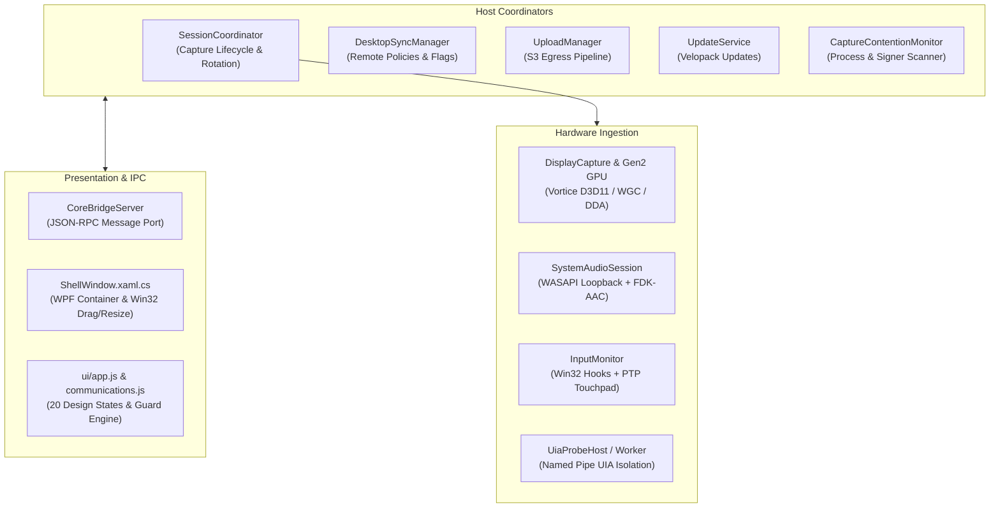

# Component Architecture & Subsystem Analysis - Kuro Windows Desktop

> **Document:** `decompiled/analysis/component_analysis.md`  
> **Source Target:** `decompiled/csharp_source/`, `decompiled/ui/`

---

## 1. Subsystem Decomposition

The decompiled codebase decomposes into 8 autonomous subsystems coordinated via event-driven pub/sub and atomic state snapshots:

---

## 2. Component Responsibility Matrix

| Subsystem | Key Classes | Primary Responsibility |
| :--- | :--- | :--- |
| **`SessionCoordinator`** | `SessionCoordinator`, `SessionState`, `SessionParks` | Central finite state machine (`Idle`, `Recording`, `Paused`, `PrivacyPaused`, `LowDisk`, `UpdateRequired`). Controls 300s clip rotation and multi-display synchronization. |
| **`CoreBridge`** | `CoreBridgeServer`, `CoreBridgeSnapshot`, `CoreBridgeRequest` | High-throughput bi-directional JSON-RPC server communicating with WebView2 over native Chromium message ports. Broadcasts system state snapshots. |
| **`Capture Engine`** | `DisplayCapture`, `GpuV2CaptureBackend`, `DdaGen2FrameSource`, `CaptureCadenceController`, `BgraFrameScaler`, `CursorRenderer` | Direct3D 11 and DXGI Desktop Duplication frame acquisition; hardware color space conversion (BGRA to NV12); fixed 30.0 FPS pacing; frame sidecar generation. |
| **`Input Monitor`** | `InputMonitor`, `RowSerializer`, `CapabilityUsageMonitor`, `PrivacyManager` | Low-level Win32 hooks (`WH_MOUSE_LL`, `WH_KEYBOARD_LL`); 8ms mouse coalescing; window focus hooks; clipboard monitoring; real-time privacy masking. |
| **`Precision Touchpad`** | `TouchpadChannel`, `HidInterop`, `PtpDevicePlan`, `PtpFrameAssembler`, `PtpGestureMachine` | Direct HID digitizer packet parsing (usage page 0x0D); contact tracking; pinch-to-zoom and two-finger inertial scroll recognition. |
| **`UIA Probe Helper`** | `UiaProbeHost`, `UiaProbeWorker`, `UiaGuard`, `UiaProbeProtocol` | Out-of-process accessibility tree inspector executing in a standalone MTA subprocess (`--uia-probe`) over Named Pipes to avoid COM deadlocks. |
| **`System Audio`** | `SystemAudioSession`, `AudioClient`, `SampleRing`, `AacEncoder`, `FdkAacInterop` | WASAPI loopback audio capture; lock-free ring buffering; native Fraunhofer FDK-AAC compression into `audio.m4a`. |
| **`Upload Manager`** | `UploadManager`, `S3Uploader`, `MetadataBuilder`, `UploadFailurePolicy` | Sweeps sealed segments from `.data\`; requests pre-signed URLs from Supabase; streams single-part or multipart S3 uploads; executes retention sweeps. |
| **`Device Identity`** | `DeviceKey`, `DeviceProof`, `HardwareFacets`, `TpmEndorsement`, `RemoteControlProbe` | TPM 2.0 CNG hardware key management; non-exportable ECDSA signatures; Intel/AMD EK cert validation; SMBIOS and VM hypervisor auditing. |
| **`Resilient DNS`** | `ResilientDns`, `DnsFallbackResolver`, `DnsLastGoodCache` | Multi-tier DNS failover querying Cloudflare DoH (`1.1.1.1`) and Google DoH (`8.8.8.8`) with local on-disk IP caching. |
| **`Update Service`** | `UpdateService`, `VersionFloor`, `FeedDownloader`, `AppUpdates` | Velopack update check and staging; enforces mandatory server-mandated minimum version floors. |
| **`Frontend UI`** | `ui/index.html`, `ui/app.js`, `ui/communications.js` | Zero-network HTML5/ES6 application rendering 20 discrete design states; element-from-point raycasting verification for legal guard notices. |

