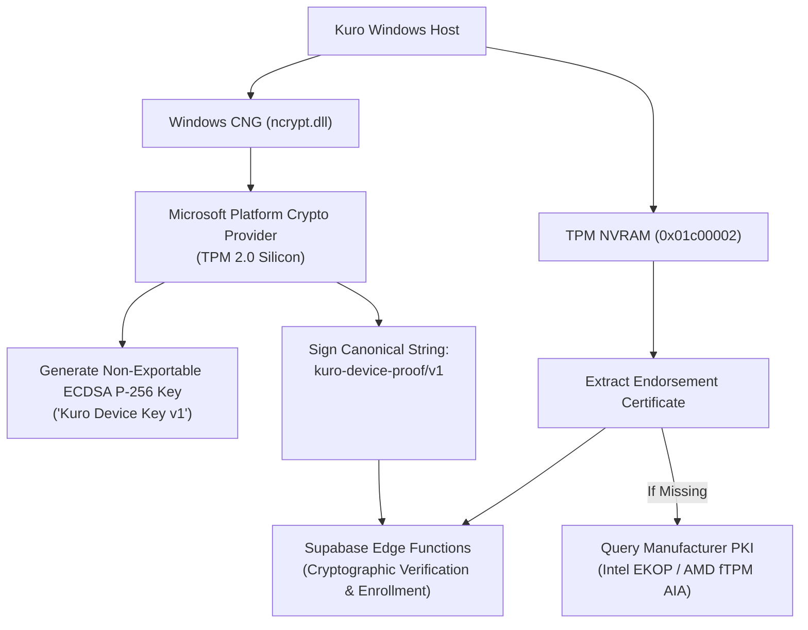

# Security & Cryptographic Analysis - Kuro Windows Desktop

> **Document:** `decompiled/analysis/security_analysis.md`  
> **Source Target:** `DeviceIdentity.dll`, `CredentialStore.cs`, `ui/index.html`

---

## 1. Cryptographic Attestation & Hardware Binding

Kuro employs hardware-grade anti-fraud defenses to ensure that contributor rewards are distributed only to authentic, physical desktop machines:



### 1.1 Non-Exportable Hardware Private Keys
- Private keys reside strictly in physical TPM 2.0 silicon.
- Configured with `NCRYPT_EXPORT_POLICY_PROPERTY = 0`, making extraction or duplication impossible even with full administrator access or memory dumps.

### 1.2 Hardware Proof Integrity (`kuro-device-proof/v1`)
Every request transmitted to Supabase Edge Functions is accompanied by three cryptographic proof headers:
- `x-device-key-id`: Unique identifier of the enrolled hardware key.
- `x-device-ts`: Millisecond ISO 8601 UTC timestamp.
- `x-device-signature`: Base64 ECDSA SHA-256 signature calculated over the HTTP method, path, timestamp, and body hash.
- **Clock Skew Rejection:** If the client's clock deviates from server time by more than acceptable thresholds, requests fail with `device_proof_invalid` (`clock`).

---

## 2. Anti-Virtualization & Fraud Heuristics (`HardwareFacets.cs`)

Kuro audits physical hardware invariants to prevent automated cloud bot farms from spoofing telemetry:

1. **CPUID Hypervisor Flag:** Inspects bit 31 of CPUID register `ECX` (Leaf `0x1`). If set, the processor is running inside a virtual machine.
2. **Hypervisor Vendor Identification:** Queries CPUID leaf `0x40000000` to identify hypervisor signatures:
   - VMware (`VMwareVMware`), VirtualBox (`VBoxVBoxVBox`), Hyper-V (`Microsoft Hv`), KVM (`KVMKVMKVM`), QEMU, bhyve.
3. **Cloud Link-Local Metadata Probe:** Executes an ultra-fast 200ms connection probe to `http://169.254.169.254`. Responses indicate AWS EC2, GCP Compute Engine, Azure VM, or Oracle Cloud instances.
4. **Remote Desktop Probing:** Interrogates `SM_REMOTESESSION` and Terminal Services session parameters (`WTSQuerySessionInformationW`) to detect RDP, TeamViewer, AnyDesk, and VNC sessions.

---

## 3. Local Credential Vault Security (`CredentialStore.cs`)

Authentication session tokens (`access_token`, `refresh_token`, `user_id`) are protected through layered operating system security:
- **Windows Credential Manager:** Primary store (`advapi32.dll` `CredWriteW` with target `com.kuro.app.auth` and type `CRED_TYPE_GENERIC`). Tokens are stored within the Windows Secure Credential Vault.
- **DPAPI Symmetric Encryption Fallback:** If Credential Manager is unavailable, tokens are encrypted with Windows DPAPI (`crypt32.dll` `CryptProtectData` with `CRYPTPROTECT_UI_FORBIDDEN`) and saved to `%APPDATA%\Kuro\auth\session.dpapi`. The encryption key is derived by the Windows kernel from the user's password hash and machine SID.

---

## 4. Presentation Sandbox Defense (Content Security Policy)

The Chromium-based frontend (`ui/index.html`) is insulated by a strict Content Security Policy:
```http
Content-Security-Policy: default-src 'none'; script-src 'self'; style-src 'self' 'unsafe-inline'; img-src 'self' data:; font-src 'self'; connect-src 'none'; base-uri 'none'; form-action 'none'; frame-ancestors 'none'; object-src 'none'
```
- **`connect-src 'none'`:** Completely blocks `fetch`, `XMLHttpRequest`, `WebSocket`, and `EventSource`. The UI cannot leak data or exfiltrate tokens to external networks.
- **`script-src 'self'`:** Disallows remote script injection and blocks inline executable strings (`eval` / `Function`).
- **`frame-ancestors 'none'`:** Prevents clickjacking and framing by external web pages.

